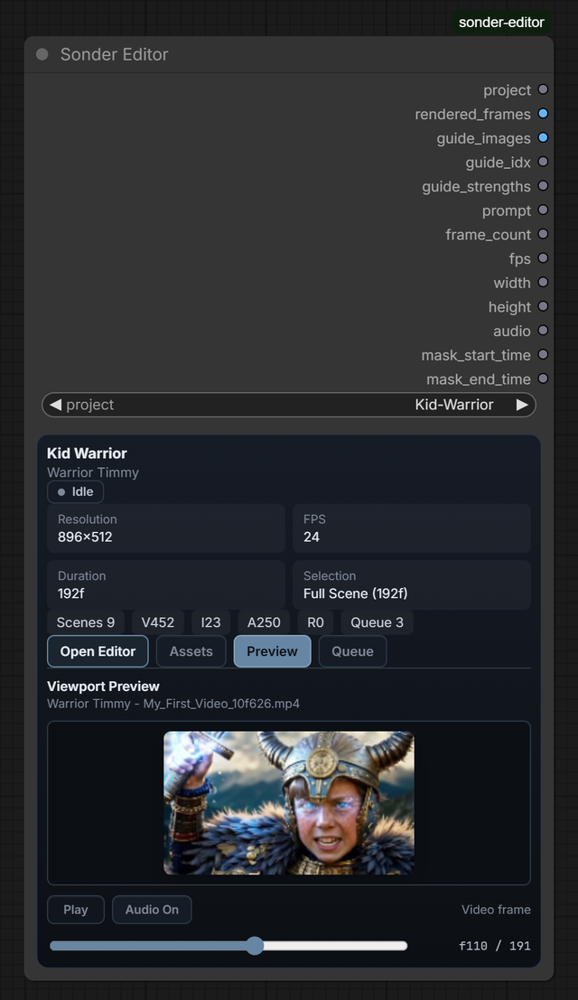

# ComfyUI-Sonder-Editor

**Version 0.8.3** — see the [CHANGELOG](CHANGELOG.md) for release notes.

Sonder Editor is a timeline-based video editing studio for ComfyUI, built for
iterative long-form video.

Create a project and arrange its scenes on a timeline: video clips, sound,
prompts that change as the scene moves, keyframes, and references for the
characters, places and voices you want to keep consistent, each placed where it
applies. Then select any range of the timeline and generate it with your own
ComfyUI workflow. Each result comes back onto the timeline as a take you can
compare with earlier ones, keep or redo.

You can drive your workflow without leaving the editor: change its settings,
switch between whole setups such as text-to-video, editing or upscaling in one
click, and turn parts of it on or off. Watch up to four views side by side: the
scene, your workflow's outputs, even a sampler's live preview while it
generates.

It works with the model you choose: LTX, Wan, HunyuanVideo, MiniMax H3 and
more.

https://github.com/user-attachments/assets/7352407c-e427-4697-9abc-da9ca76f4d4e

<p align="center"><em>From a kid in a garden to a warrior in a storm: each take
lands on the timeline beside the one it replaced.</em></p>

**[▶ Watch the launch overview](https://youtu.be/lixgY2G80xE)** (recorded at the first release)

## What it is

A project holds your media and scenes; scenes hold timelines; timelines hold
lanes. Your ComfyUI workflow carries its own Controls and Views, so they travel
with the workflow:

```
Project
├── Asset gallery       everything you import or generate
├── Reference Library   the characters, locations, props and voices it reuses
└── Scenes              each with its own length, resolution and frame rate
    └── Timeline        the lanes you arrange, shown in the viewport
        ├── Video and audio lanes
        ├── Prompt lanes      text that changes along the timeline
        ├── Guide lane        keyframes pinned to exact frames
        ├── Driver lanes      video that steers without appearing
        └── Reference lanes   when each Reference applies

Workflow (your ComfyUI graph)
├── Sonder Editor       the node that hands the timeline to your graph
└── Controls            the settings shown in the editor's Controls tab
    ├── Settings        any node widget you expose, in groups with notes
    ├── Modes           whole setups switched in one click
    ├── Switches        nodes and groups turned on or off
    └── Views           outputs shown in the viewport panes
```


<p align="center"><em>Controls and Modes at the left; the viewport split into
the shot, its depth map and a live sampler preview.</em></p>

<p align="center">
  
</p>
<p align="center"><em>One native node in your graph, with outputs only.</em></p>

<a id="the-node-in-your-graph"></a>
You add one node, **Sonder Editor**. **Open Editor** on its card opens the
editor over the whole browser window, and **Mount in Tab** moves it to a tab of
its own so the graph stays in view. Closed, the node keeps a small card with the
project, a preview and the queue. Its outputs, and the smallest graph that uses
them, are in [Wiring your graph](docs/generating.md#wiring-your-graph).

## Highlights

What you can do from the editor:

| You want to… | Use… |
|---|---|
| Organize your work | [Projects and scenes](docs/editor-basics.md#creating-a-project), with [folders, favorites and media recovery](docs/assets-and-gallery.md) |
| Arrange picture and sound | [Video and Audio lanes](docs/editor-basics.md#the-timeline): move, trim, split, layer and play media |
| Describe what happens | [Global text and timed Prompt sections](docs/prompts.md), from a plain text field to structured instructions |
| Guide the result | [Guides and Drivers](docs/generating.md#guides), or [reusable References](docs/references.md) staged where they apply |
| Choose what to generate or change | [In/Out, surrounding context and picture/sound masks](docs/generating.md#the-generation-window) |
| Set up your workflow from the editor | Workflow [Controls, Modes and node switches](docs/controls.md) |
| Watch your workflow's outputs | [Output Views](docs/generating.md#output-views): up to four viewport panes beside the scene, including a sampler's live preview |
| Review takes and try again | [Takes](docs/assets-and-gallery.md#takes), with [inspection and A/B comparison](docs/assets-and-gallery.md#compare-mode) |
| Prepare several generations | The [Render Queue and Batch](docs/generating.md#the-render-queue) controls |
| Export the finished scene | [Timeline Export](docs/assets-and-gallery.md#export-timeline), which combines the arranged picture and sound into a file |
| Generate from a page of its own | The [Sonder App](docs/sonder-app.md) (experimental, optional) |

<a id="quickstart"></a>
New here? Install the pack, then follow
[Make a first take](docs/getting-started.md#make-a-first-take).

## See it work

Four things you do in the editor, from selecting a range to switching a whole
setup.

### Redo just one part

Keep the take you like and redo a stretch of it: set **In** and **Out**, keep the
frames before as context, and the new take lands on its own lane, ready to play
beside the first. See [Redo a part of a clip](docs/getting-started.md#redo-a-part-of-a-clip).

https://github.com/user-attachments/assets/3b87d262-5496-4870-aff0-2990dfc3ef5a

### Keyframes

Drop pictures on the timeline at the frames you choose, and the take passes
through each of them. See [Guide with frames](docs/getting-started.md#guide-with-frames).

https://github.com/user-attachments/assets/45173cea-0c39-4c88-a834-84def9f45bd6

### References

Keep characters, places and voices consistent: add them to the Reference Library,
place them on a lane where they apply, and attach them to a prompt. See
[Use a Reference](docs/getting-started.md#use-a-reference).

https://github.com/user-attachments/assets/94c5cc41-ad33-4ad2-8907-bc05f952cc2f

### Controls and Modes

Each button is a whole setup: it switches parts of your workflow on and off and
sets its values together. See [Modes](docs/controls.md#modes).

https://github.com/user-attachments/assets/d63c740f-1e94-44c9-806f-bcbe36ec2516

## Examples

<a id="example-workflows"></a>
<a id="example-projects"></a>
Five ready-wired workflows. Drop any of the files onto the ComfyUI canvas, or open
them from ComfyUI's **Templates**, under **Extensions › sonder-editor**.

<a id="prompt-relay"></a>
<a id="guides"></a>
<a id="ic-lora-motion-transfer"></a>
**[Sonder LTX 2.3 Playground](example_workflows/sonder_ltx_2_3_playground.json)** —
prompt relay, multi-pass upscaling, image guides, and driver-controlled generation.
Its matching project is **Project-Sample**, listed under
[**Project Sample — LTX 2.3**](https://huggingface.co/datasets/SonderSaid/Sonder-Editor-Projects#project-sample--ltx-23) on Hugging Face,
with four scenes of media, prompts, guides and generated takes.

**[Sonder MiniMax H3 References](example_workflows/sonder_minimax_h3_references.json)** —
References driving MiniMax H3: Reference lanes reaching the model through the
Reference Selector and the Image and Audio bridges, first- and last-frame guides
through the Guides Bridge, separated AV latents, and the Masks Bridge writing
latent noise masks so a window can be regenerated in place.
Its matching project is
[**Project Sample: MiniMax H3 References**](https://huggingface.co/datasets/SonderSaid/Sonder-Editor-Projects#project-sample-minimax-h3-references)
on Hugging Face, the project behind the western showcase, and needs Sonder
Editor 0.6.0 or newer.

**[Sonder MiniMax H3 References & Swaps](example_workflows/sonder_minimax_h3_references_swaps.json)** —
swap a person in existing footage for someone new, keeping the original
performance and sound, or generate with MiniMax H3 from picture, video and sound
references. Pick the task in [Modes](docs/controls.md#modes). Its notes in
Controls cover setup, models and the steps for each task.

https://github.com/user-attachments/assets/c89a15ea-a3c3-4f22-b6b0-a6de1f8923e1

**[Sonder LTX 2.5 Edit & VFX](example_workflows/sonder_ltx_2_5_edit_vfx.json)** —
LTX 2.5 editing and effects, each one a choice in [Modes](docs/controls.md#modes):
edit footage with a prompt or an edited picture, remove people, make a subject
mask, follow a video's layout, body movement or outlines, add sound to a video,
or make new video and sound. Its notes in Controls list the node packs and model
files and walk through a first take.

https://github.com/user-attachments/assets/7b998aeb-3db5-4363-af22-fea4a6a6b0bb

**[Sonder LTX 2.5 Refine & Upscale](example_workflows/sonder_ltx_2_5_refine_upscale.json)** —
refine existing footage at the timeline resolution, upscale it to twice the
timeline's width and height, or do both. Optional character or background masking
focuses the refine pass. Its notes in Controls cover setup, models and downloads,
mask preparation, and saving results with sound.

https://github.com/user-attachments/assets/38af328d-0596-4ed1-8a14-4ab9e9cb79dd

The last three also ship with the [Sonder App](docs/sonder-app.md)
(experimental, optional) as its starter workflows, exported for the API.
[Sonder App Workflows](docs/sonder-app-workflows.md) has the steps for each of
their tasks in the app.

Every sample project, with its matching workflow, showcase video, tested editor
version and opening instructions, is on
[Hugging Face](https://huggingface.co/datasets/SonderSaid/Sonder-Editor-Projects).

## Models

Sonder generates nothing itself, so what a project can do depends on the model
and workflow wired underneath it. **Model templates** carry each model's legal
frame counts, FPS and resolution rules, so the timeline snaps to what your
graph can actually render.

Built in: **No Model Template** (no constraints), **LTX 2.3 / 2.5**, **MiniMax H3**,
**Wan 2.1 / 2.2 (14B)**, **Wan 2.2 (TI2V-5B)**, **HunyuanVideo 1.5**,
**CogVideoX 1.5 (T2V)** and **CogVideoX 1.5 (I2V)**. You can add your own;
[Generating](docs/generating.md#model-templates) covers templates and
[which feature needs which model capability](docs/generating.md#what-your-model-needs).

## Nodes

**Sonder Editor** is the only node you always add — the rest are optional pipeline
adapters, grouped under the `Sonder`, `Sonder/IO`, `Sonder/Logic`, and
`Sonder/Controls` menus in ComfyUI.

### Editor & generation bridges — `Sonder`

| Node | What it does |
|------|--------------|
| **Sonder Editor** | The main editor and output node: timeline, scenes, gallery, and render queue. |
| **Sonder Guides Bridge Start / End** | Paired loop nodes that wrap a generation body to inject per-frame guide images. |
| **Sonder Driver Selector** | Picks a Driver lane without decoding it and outputs `has_driver`, so you can skip the driver branch when the lane is empty. |
| **Sonder Driver Bridge** | Decodes the selected Driver lane's frames for the generation window, with its start frame and strength. |
| **Sonder Reference Selector** | Picks one or more Reference lanes without decoding them and outputs `has_reference` and the strength; see [Wiring the nodes](docs/references.md#wiring-the-nodes). |
| **Sonder Reference Image Bridge** | Outputs the selected lanes' images (and MiniMax H3 video sequences) on `r01`–`r16`. |
| **Sonder Reference Audio Bridge** | Outputs the selected lanes' trimmed audio on `a01`–`a16`. |
| **Sonder Reference Prompt Bridge** | Outputs the selected lanes' prompt text: `reference_prompt`, `reference_names`, and `p01`–`p16`. |
| **Sonder Masks Bridge** | Outputs the generation window's picture and sound masks, each set to **Edit** or **Freeze**; see [Masking an audio-video latent](docs/generating.md#masking-an-audio-video-latent). An optional spatial mask limits the video edit to a moving region; see [Edit a moving region](docs/generating.md#edit-a-moving-region). |
| **Sonder Prompt Relay Bridge** | Exports the generation window's prompt lanes as ComfyUI-PromptRelay payload strings (no model patching). |

### Save & preview — `Sonder/IO`

| Node | What it does |
|------|--------------|
| **Sonder Save Video** | Encodes frames (and optional audio) to a project video asset, or a take placed on the timeline; `color_drift_correction` (on by default) evens out color drift against the context frames. |
| **Sonder Save Bridge** | Gives another save node a folder in the project, then adds what it wrote to the gallery. |
| **Sonder Preview Video** | Encodes frames to a temporary video for in-UI preview playback. |
| **Sonder Metadata Collector** / **Sonder Metadata Collector Nodes 2.0** | Record the upstream values you wire in (steps, seed, LoRA…) in the generated asset's details. Use the Nodes 2.0 entry for new workflows when your ComfyUI offers it. |

### Routing & logic — `Sonder/Logic`

| Node | What it does |
|------|--------------|
| **Sonder Selector** | Selects one label from a newline-delimited list and outputs its text plus zero-based index. |
| **Sonder Switch** | Routes any one data type across N branches; evaluates only the selected branch on ComfyUI 0.40+ ([older-core limitation](docs/troubleshooting.md#sonder-switch-runs-every-branch-or-reports-a-selected-branch-unavailable)). |
| **Sonder Cluster** | Routes a shared branch selection across multiple lanes, each lane carrying its own type (lazy). |
| **Sonder Gate** | Per-lane lazy gate: each lane's condition decides whether its value is evaluated and passed on or skipped entirely, emitting nothing. Place it directly in front of an optional input — for example after a resize fed by a Reference Bridge slot set to `nothing`. |

### Controls — `Sonder/Controls`

| Node | What it does |
|------|--------------|
| **Sonder Control Relay** | Shows the workflow settings you choose in the editor's **Controls** tab; see [Controls](docs/controls.md). |

> **Sonder Switch**, **Sonder Cluster**, **Sonder Gate**, **Sonder Reference Selector**, the three
> **Sonder Reference Bridges**, **Sonder Control Relay**, and
> **Sonder Metadata Collector Nodes 2.0** use ComfyUI's
> newer V3 node API and load only on recent ComfyUI builds. On older builds
> the rest of the pack loads, with **Sonder Metadata Collector** under its
> normal name.

## Requirements

- **ComfyUI** — 0.8.3 was validated on ComfyUI **0.44.0** with frontend
  **1.58.5**. That is what this release was tested against, not a minimum;
  other versions are expected to work. The V3 nodes listed under Nodes load
  only on builds that provide `comfy_api`. A View pane's **Run** needs ComfyUI
  0.42.0 or newer; on older builds it doesn't show.
- **Python 3.10+** (matching your ComfyUI environment; validated on 3.12).
- **FFmpeg 7.0+** — required for video/audio decode, encode, and export. The
  `imageio-ffmpeg` dependency (0.6.0 or newer) bundles one. A system `ffmpeg`
  on your `PATH` gives the widest format support but is used first, so update
  an older one or remove it from `PATH`.
- `torch` is provided by ComfyUI and is **not** installed by this pack (see
  [Troubleshooting](docs/troubleshooting.md)).
- **Optional, for the [Sonder App](docs/sonder-app.md):** `comfy-sdk` 0.4.0 and
  `comfy-api-proxy` 0.1.6 (any 0.4.x and 0.1.x work). Install them from the
  editor's Settings, not with `pip install -r requirements.txt`; the editor and
  every node work without them.

## Installation

### Option A — ComfyUI-Manager (recommended)

Search for **Sonder Editor** in ComfyUI-Manager and install, then restart
ComfyUI.

### Option B — Manual (git clone)

```bash
cd ComfyUI/custom_nodes
git clone https://github.com/SonderSaid/ComfyUI-Sonder-Editor.git
cd ComfyUI-Sonder-Editor
pip install -r requirements.txt
```

Then restart ComfyUI. The pack registers its nodes and serves its web UI
automatically.

## Documentation

- **[Getting Started](docs/getting-started.md)** — step-by-step instructions: a first
  take, extending, batching, redoing part of a clip, guides, Drivers,
  References, watching a sampler, and export.
- **[Editor Basics](docs/editor-basics.md)** — opening the editor, projects,
  layout, the viewport and its panes, timeline, item types, gestures, and
  shortcuts.
- **[Generating](docs/generating.md)** — the generation window, model
  templates, guides, Drivers, wiring your graph, the render queue, what's
  frozen vs. live in queued jobs, and Output Views.
- **[Prompts](docs/prompts.md)** — Prompt Management, how a prompt is composed,
  Channel Templates, prompt formats, Context chips and Prompt Relay.
- **[References](docs/references.md)** — the Reference Library, Reference
  lanes and recipes, Reference prompting, and the Reference nodes.
- **[Assets & Gallery](docs/assets-and-gallery.md)** — asset lifecycle,
  tracked metadata, takes, inspect/compare, timeline export, and audio fidelity.
- **[Controls](docs/controls.md)** — workflow settings, Modes and node
  switches in the editor, Manage, and sharing Controls.
- **[Sonder App](docs/sonder-app.md)** (experimental, optional) — setup, the
  Launcher, preparing your own workflows, the
  [Sonder App Workflows](docs/sonder-app-workflows.md) instructions, and
  [the node packs and model files](docs/sonder-app-setup.md) each workflow
  needs.
- **[Troubleshooting](docs/troubleshooting.md)** — installation and
  environment problems, project storage and Windows path limits, the Sonder App,
  and playback.

## Security & metadata

- Sonder Editor stores projects as local files under ComfyUI's configured output
  area. Do not expose a ComfyUI instance running this pack to untrusted networks
  unless you have put ComfyUI behind your own authentication and network
  controls.
- Generated files can embed ComfyUI prompt/workflow metadata when
  `embed_metadata` is on in **Sonder Save Video**. Turn that off before sharing
  files if your graph, prompts, paths, model names, or node settings are private.
- Project `media/`, `cache/`, and generated output folders are user data, not
  source distribution files. Do not commit them to a public repository.
- **Allow External Project Links** (**Settings ▸ Server**) is off by default.
  Enabling it makes this ComfyUI installation follow project and media symlinks/junctions
  wherever the editor resolves files. Treat every linked folder as readable by
  anyone who can reach your ComfyUI server.

## Troubleshooting

Installation, project storage, Sonder App and playback fixes are in
[Troubleshooting](docs/troubleshooting.md).

## License

**ComfyUI-Sonder-Editor** — Copyright (C) 2026 SonderSaid

This program is free software: you can redistribute it and/or modify it under
the terms of **version 3 of the GNU General Public License** as published by the
Free Software Foundation.

This program is distributed in the hope that it will be useful, but WITHOUT ANY
WARRANTY; without even the implied warranty of MERCHANTABILITY or FITNESS FOR A
PARTICULAR PURPOSE. See the [GNU General Public License](LICENSE) for details, or
visit <https://www.gnu.org/licenses/>.
