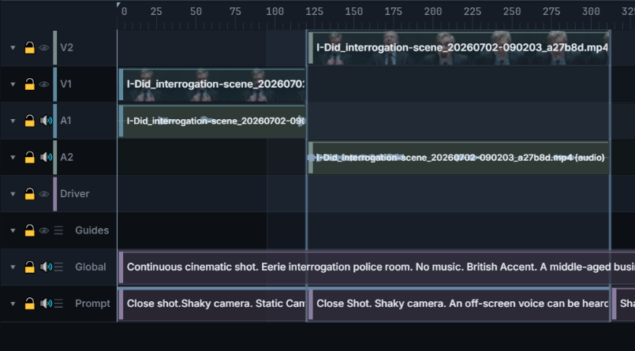
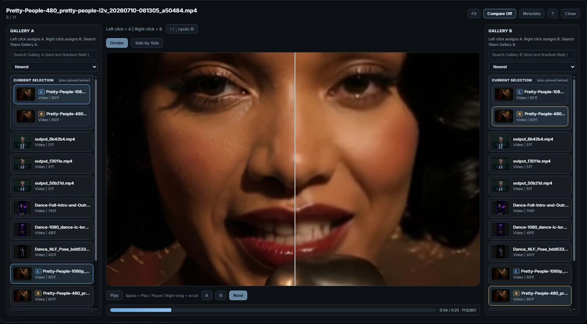
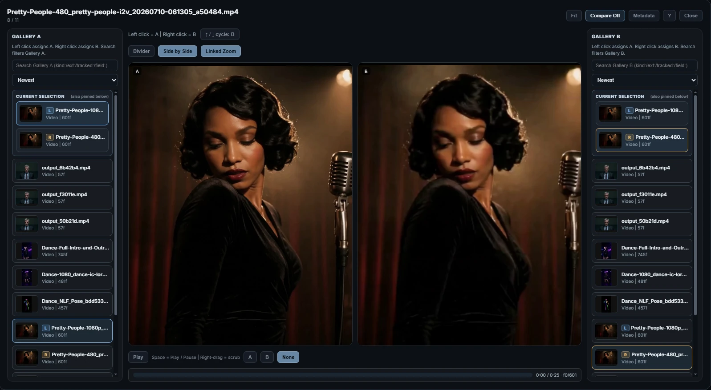
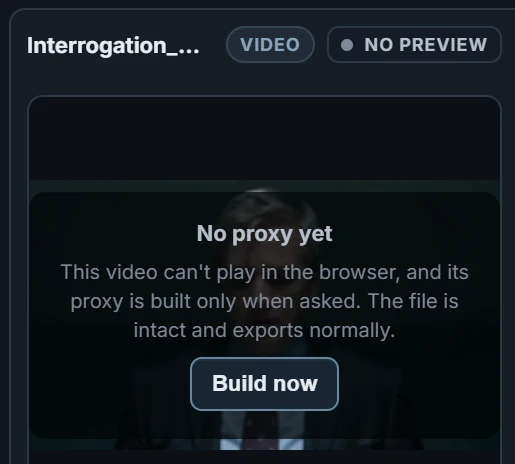

# Assets & Gallery

Every piece of media in a project — imports, generated takes, captures,
exports — lives in the **asset gallery** under **Assets** in the editor's left sidebar. The
same gallery powers the dormant node card's Assets module.

The fullscreen and mounted sidebar also has a **References** tab. It groups
reusable image, voice, and video assets into project-level characters, locations,
props, and outfits; see [References](references.md).

Editing with these assets is covered in [Editor Basics](editor-basics.md);
generation in [Generating](generating.md).

## Finding things

- **Type tabs** with live counts — All · Videos · Images · Audio ·
  Artifacts.
- **Scope** — *All*, *Favorites*, or *Current Scene* (everything the active
  scene references through clips, Drivers, audio, and guides — including
  muted, hidden, and even trashed-but-referenced assets).
- **View** — *Folders* (collapsible groups, `Root` included) or *Flat*.
- **Sort** — Newest, Oldest, Name, Type, Duration, Resolution.
- **Search** — free text matches display names, plus token filters:
  `kind:` and `ext:` for artifacts, and `field:<name>=<value>` /
  `tracked:<text>` for tracked generation metadata (see below).

Rows carry badges: a **Scene** marker when the active scene uses the asset,
a **★ favorite** star, and a **Missing** placeholder when the file is gone
but the entry survives.

**Importing**: the Import button, dropping OS files onto the gallery
(imports into the hovered folder), or dropping an OS *folder* (imports as a
gallery folder). Imports are copied into the project folder, so the project
keeps working if the originals move. Drag a row onto the timeline to place it — the drop-zone
rules are in [Editor Basics](editor-basics.md#dropping-assets-onto-the-timeline).

## Asset lifecycle & safety

- **Rename** changes the display name only — the file on disk is never
  renamed.
- **Replace File…** swaps the media behind an asset while keeping the asset
  identity and every reference to it.
- **Move to Trash** is a soft delete: the asset moves to the **Trash**
  virtual folder at the bottom of the gallery, references stay recoverable,
  and **Restore** returns it to its original folder. Only **Delete
  Permanently** and **Empty Trash** are destructive. Trash can auto-purge by
  age/size (Settings ▸ Render).
- After **Delete Permanently** or **Empty Trash**, an asset's uses on the
  timeline and in the queue become **Missing** placeholders, and it leaves any
  Reference it belonged to.
- **Missing assets** (file moved or deleted on disk) keep their entry and
  references — **Relink…** points them at the file again and everything
  reconnects.
- **Where Used…** answers "can I safely delete this?" — a grouped summary with
  per-reference rows for clips, guides, audio, generation jobs, and Reference
  Library members.
- **Open Source Workflow** loads the ComfyUI workflow embedded in a
  generated file (PNG/MP4/M4V/MOV/MKV) straight onto the canvas.

## Generated assets & tracked metadata

Assets produced through the save nodes with a **Sonder Metadata Collector**
in the graph show a **tracked metadata** section in the inspector, above the
raw generation dump:

- **Field rows are clickable filters** — clicking toggles a
  `field:<name>=<value>` search token ("show me everything generated with this
  seed/model/LoRA").
  Free-form tracked search uses `tracked:<text>`.
- **Pins** lift fields you care about to a *Pinned Fields* card at the top
  (right-click a field or section header). Pins re-apply to any asset
  exposing the same labels.
- A **Raw** collapsible keeps the untouched generation dump.

**Artifacts** (latents, JSON, checkpoints, other backend outputs) are
first-class gallery entries: searchable and inspectable with a metadata
card, but they render no media preview and can't be dropped on the timeline.

## Takes

A **take** is one generated version, saved by **Sonder Save Video** with
**mode** set to **Take**. It lands in **Assets** under **Takes**, in a folder
named after the scene, and on its own Video row, with its sound on a linked
Audio row. Takes reuse an empty row after the last occupied row when it is
unlocked and visible; otherwise they add a row.

How takes land is set in **Settings** (the **⚙** at the right end of the
toolbar) **▸ Render**. **Takes start muted** and **Link take video + audio**
also appear in the **Editor** group of the [Controls](controls.md) tab:

- **Take Placement Mode:** **Trimmed** places the Selection, plus any context
  you include with the **GEN** box's **Mask** − / + fields. **Untrimmed** also
  places the context frames, for checking seams.
- **Link Take Video + Audio:** picture and sound move and mute together.
- **New Takes Start Muted:** a new take doesn't change what plays until you
  unmute it.
- **Keep Take Padding:** off by default. Some models need a set number of
  frames, so they render a few extra at the end. Tick it to place those frames
  too.

### Placing a take again

Drag a take's row from **Assets** onto the timeline to put it back the way it
was generated. **Restore Take Placement** (**Settings** ▸ **Timeline
Behavior**, on by default) controls this:

- **In the take's own scene**, it lands at its original time with its
  original trim, wherever along the row you drop it.
- **On the ruler**, its sound comes back too, on a new Audio row. The two are
  linked when **Link Dropped Video + Audio** (**Settings** ▸ **Timeline
  Behavior**) is on.
- **On an Audio row**, only its sound comes back, with the same trim. If the
  take has no sound that can be recovered, nothing is placed.
- **In another scene**, it starts where you drop it, with the same trim. If
  that scene has another frame rate, the trim is converted to keep the same
  seconds.
- The frames outside the trim stay in the clip: drag its edges to show them.

With **Restore Take Placement** off, a take drops whole at the cursor like any
other media, in its own scene too.

### Which takes should start muted

The timeline renders what is visible, so an unmuted take in front becomes the
source of the next render over that range.

- **Muted:** you are trying several versions of the same selection at a
  denoise below 1. Each attempt then starts from the original, not from the
  last take.
- **Unmuted:** each take should feed the next, as when chunks of a batch or an
  extension continue from the take before them.
- **Either:** at full denoise the source picture is regenerated anyway.

For sound, keep **place_audio_on_timeline** on **Sonder Save Video** when you
generate new sound and want later takes to continue from it. When the sound is
frozen (**Sonder Masks Bridge** **edit_audio** on **Freeze**), turn it off, so
the same audio isn't stacked on a new row with every take.

**Choosing the take that plays.** Higher-numbered Video rows appear in front.
To keep one take, right-click it and choose **Unmute Selected**, then mute the
competing takes with **Mute Selected**, or hide their Video row with the eye at
the left of the row. Click **Play** under the preview to check picture and
sound. A favorite star in **Assets** doesn't change what plays.

To switch only the picture and keep the sound, hide the Video row, or unlink
the take first ([Linked groups](editor-basics.md#linked-groups)).

## Manage mode & bulk actions

**Manage** toggles multi-select (checkboxes; Ctrl/Shift-click also work in
normal browsing). With a multi-selection, a bulk toolbar appears: **Move**
and **Trash** for active assets, **Restore** and **Delete Permanently** for
trashed ones.

## The inspect overlay

Double-click (or Space) a gallery asset for fullscreen inspection.

- **Images** — wheel zoom pivots toward the cursor up to **16×** for
  pixel-level checks; left-drag pans; `F` fits.
- **Video** — Space plays/pauses; ←/→ steps one frame (Shift = 10,
  Ctrl = 1 s); **right-drag anywhere on the video scrubs** from the current
  playhead; the scrub bar handles absolute seeks.
- **Audio** — an interactive waveform: click/drag seeks, the played portion
  highlights.
- ↑/↓ cycle through assets without leaving the overlay.

## Compare mode

**Compare** puts two same-type assets side by side, for take review. To open
it, click **Assets** at the upper left, double-click a result to inspect it,
then click **Compare** in the inspection overlay (or press **C** there). To
make the winner the take that plays, see [Takes](#takes).

- **Layouts** — a screen-fixed **divider** over one shared stage (pan/zoom
  moves both together), or explicit **side-by-side**, where a further toggle
  switches between **Linked Zoom** and **Independent Zoom**.
- **Pickers** — left-click assigns A, right-click assigns B, and the current
  pair stays pinned at the top of both lists. Each side gets its own search box
  and keeps its own scroll position; a sticky toggle chooses which side the
  arrow keys cycle, so you can hold one take fixed and flip the other through
  candidates.
- **Video** — linked transport; an **A | B | None**
  control picks which side's audio plays.
- **Audio** — stacked waveforms; monitor **A / B / Both / Mute** on keys
  `1 / 2 / 3 / 0`, hold Shift to momentarily flip sides.
- **Metadata** — panels flank the media (A left, B right). Left-click a
  tracked field to filter the **A** picker, right-click to filter **B** —
  compare takes against their own generation parameters.
- **Favorites** — each side carries a star in its corner of the stage, faint
  until you hover; click it to favorite that side. `S` favorites the side the
  arrow keys cycle, and the pickers mark favorites with ★. Opened from the
  **Favorites** scope, compare becomes an elimination round: unfavorite the
  weaker take and the next one in that side's list steps in, until the last
  favorite of that type is left, shown in single view. Single Inspect in the
  Favorites scope moves on to the next favorite instead of closing.

## Proxies

You don't add proxies yourself. Your browser can't play some video formats,
such as ProRes and Lossless FFV1 (RGB), so when such a video arrives (an
import, a take, a Save Bridge file, an export), Sonder makes a **proxy**: a
playable copy, unless **Build Proxies** is set to **Only when I ask**. The viewport, the gallery, Inspect, Compare and **Crop, Trim &
Preview** show the proxy; render, export, Add frame to guides and the graph
always use the original file.

Until a proxy is ready, the viewport shows a notice where the clip would be,
and the gallery's inspector shows a badge next to the video's name:

| Gallery badge | Viewport notice | What it means |
|---|---|---|
| **Proxy** | (the clip plays) | Previews play its proxy. |
| **Building Proxy** | **Building proxy…** | The proxy is being made. |
| **Proxy Queued** | **Proxy waiting for ComfyUI** | It builds once ComfyUI has been idle for 30 seconds. |
| **Proxy Queued** | **Proxy queued** | A build is queued. |
| **Proxy Queued** | **Can't play this video here** | Your browser couldn't play the original, so a build is queued. |
| **Proxy Failed** | **Proxy failed** | No proxy could be made. |
| **No Preview** | **No proxy yet** | Proxies are built only when you ask, or this one was deleted. |

<em>The inspector for a ProRes clip in a project set to
<strong>Only when I ask</strong>.</em>

To build a proxy now, whatever the timing setting:

- in the inspector or in Inspect, click **Build now** under the notice, or
- right-click the video in the gallery and choose **Build Proxy Now**.

Other gestures, by right-clicking a video in the gallery:

- **Create Proxy** — a proxy for a video that already plays, for example a
  large file that scrubs slowly. It follows the **Build Proxies** setting.
- **Rebuild Proxy** — makes it again with the current proxy preset.
- **Remove Proxy** — deletes it. A video that can't play shows the notice
  again until you build it.
- With several videos selected: **Create Proxies for N videos**.

In **Settings** (the **⚙** at the right end of the toolbar) **▸ Proxies**:

- **Proxy Preset (project-wide)** — **Compatible MP4**, **High Quality MP4**
  (default) or **Editing Master MP4**. A change applies to new proxies; to
  redo existing ones, use **Regenerate Proxies…**.
- **Build Proxies (project-wide)** — **When ComfyUI is idle** (default:
  builds start once ComfyUI has had nothing to run for 30 seconds and stop
  when a prompt starts), **Right away**, or **Only when I ask** (nothing builds
  by itself).
- **This Project's Proxies** shows how many proxies the project has and their
  size, with two buttons. Each opens a dialog with a checkbox per group:
  **Used in scenes**, **Used by References** and **Unused**.
  - **Regenerate Proxies…** rebuilds the proxies in the checked groups and
    builds missing ones for videos that can't play.
  - **Delete Proxies…** deletes the proxies in the checked groups. Proxies of
    trashed videos are always deleted.

## Export timeline

Export saves the arranged picture and sound of one scene. For the steps, see
[Export the timeline](getting-started.md#export-the-timeline).
The toolbar's **Export** dialog offers:

- **Save presets** — Compatible MP4, High Quality MP4, Editing Master MP4,
  ProRes 422 HQ, Lossless FFV1 (RGB), or Custom with expert encode
  controls.
- **Include video / audio** checkboxes, and **Place as take** to drop the
  result straight onto a fresh lane in the active scene (with optional
  linked, muted take placement).
- Exports land in the gallery's `Exports` folder; place-as-take exports land
  in Root.

## Audio fidelity

Saved and previewed results may be lowered in volume to leave peak headroom;
quiet material is not boosted. Check the result in the gallery before
delivery.

A video export has no audio stream when its window has no audible tracks.

Choose the delivery format your editing or playback software accepts.
**Editing Master MP4** uses FLAC audio; check that your editor can read it
inside MP4. Audio-only exports with that preset use `.flac`.

| Preset | Audio delivery |
|---|---|
| Compatible MP4 | AAC, 192 kb/s |
| High Quality MP4 | AAC, 256 kb/s |
| Editing Master MP4 | FLAC, 24-bit |
| ProRes 422 HQ | PCM, 24-bit |
| Lossless FFV1 (RGB) | FLAC, 24-bit |

**Custom** lets you choose other audio settings, including 16-bit PCM.
Browser playback can sound different from the saved file; listen to the
export in its target player or editor.

## Gallery & overlay shortcuts

### Gallery (focused)

| Key | Action |
|---|---|
| Arrow keys | Move asset focus (inspector follows) |
| Space | Open the inspect overlay |
| Ctrl+A | Select all visible |
| S | Favorite / unfavorite |
| Delete | Trash (or permanently delete a trashed selection) |
| Esc | Clear or reduce selection |

### Inspect overlay

| Key | Action |
|---|---|
| ← / → | Video: step 1 frame · Image/Audio: previous / next asset |
| Shift+← / → | Video: step 10 frames |
| Ctrl+← / → | Video: step 1 second |
| ↑ / ↓ | Previous / next asset (compare: cycle the active side) |
| Space | Play / Pause |
| Right-drag video | Scrub from the current playhead |
| 1 / 2 / 3 / 0 | Audio compare monitor: A / B / Both / Mute |
| Shift (hold) | Temporarily flip the A/B monitor |
| C | Toggle Compare |
| S | Favorite / unfavorite (compare: the side ↑ / ↓ cycles) |
| Delete | Move to Trash |
| F | Fit |
| + / − | Zoom |
| Wheel | Zoom (image/video) / waveform zoom (audio) |
| Esc | Close |
