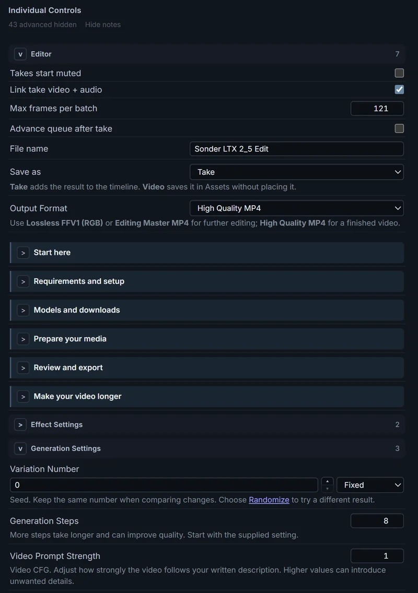

# Controls

Change a workflow's settings — steps, a sampler, a seed, a Selector choice —
from the editor, without going back to the graph. The settings come from a
**Sonder Control Relay** node in the workflow.

## Open the Controls tab

In the editor, click the **Controls** tab in the sidebar at the left, beside
**Assets** and **References**.

The **Editor** group at the top holds take settings such as
**Takes start muted**. Below it are the settings the workflow exposes, under
the group names its author chose.

<em>The Controls tab with the Editor group and one
workflow group, Generation, which starts with an author's note.</em>

A workflow without Controls says *No Controls yet*. Click
[Manage](#manage) and add a setting; on the canvas, the editor adds the
**Sonder Control Relay** node to the graph for you (one per workflow).

For a workflow that already has Controls, [Modes](#modes) and notes, open
**Sonder LTX 2.5 Edit & VFX** from [Examples](../README.md#examples).

## Change a setting

Click a value and change it. Long option lists have a filter at the top. A
seed shows its mode beside it (fixed, increment, decrement, randomize).

In the Sonder App, values are saved for that imported workflow.

A setting whose node is muted or bypassed (or sits inside a muted or bypassed
subgraph) shows **Muted** or **Bypassed** beside its name; hold the pointer over
that tag to see which node is off. You can still change it: the node stays off,
and the value applies once the node runs again.

A setting that can't be used — its node was removed or is linked to another
node — says why and is skipped, so the workflow's own value runs.

To see only the settings, click **Hide notes** in the small line near the top
of the Controls tab, under the search box (and under the **Modes** table when
the workflow has one). The workflow's notes disappear, both the standalone
ones and the ones under a setting; it then reads **2 notes hidden** (your
count), which you click to bring them back. Settings the workflow marks Advanced start
hidden the same way: the line reads **1 advanced hidden** (your count); click
it to show them. Both choices are also checkboxes in **Settings → Controls**
(**Show notes** and **Show advanced settings**), and each browser remembers
them. Hidden settings keep and apply their values. [Manage](#manage) shows
everything, and a search shows every setting it matches, with its note.

Each take records the values it used. Open the take in **Assets** and look for
**Controls at run** in its details.

## Switch nodes and groups on and off

A workflow can expose a node, a subgraph or a canvas group as a switch with
three buttons: **Enabled**, **Muted** and **Bypassed**. Click one to set every
node it covers, like ComfyUI's own mute and bypass. On the canvas, one Undo
reverts the switch.

- A group switch covers the nodes inside the group on the canvas at the moment
  you click. When its nodes differ, no button is selected and it reads, for
  example, *Mixed (1 of 2 off)*.
- Two switches can cover the same node (a group and a node inside it). The
  last one you click decides.
- On the canvas, the **Sonder Control Relay** node shows each switch's state
  (*Muted — switch in Controls*).
- In the Sonder App, switches work the same way, and **Generate** runs the
  workflow as ComfyUI would with those nodes off. A switch works there only if
  every node it covers was on when you used **Export (API)**; otherwise it is
  greyed out and says how to fix it. To hide a switch you don't need, click
  **Manage**, then **Hide** on its row.
- If your switches turn off every **Sonder Save Video** and **Save Bridge**,
  **Generate** says so instead of running: no take could land.

To add one, see [Manage](#manage).

## Modes

A workflow can group whole setups into **Modes**. Each row of the **Modes**
table is a **category**, such as *Task* or *Look*, and its buttons are the
**choices** in it, such as *Text to video* and *Image to video*. One choice
sets several Controls at once, and can switch nodes on and off too: for
example, a **Skip** choice in a *First pass* category that mutes the first
pass's group and sets the second pass's input. A Mode is not a node switch's
**Enabled** / **Muted** / **Bypassed**: those are single
[switches](#switch-nodes-and-groups-on-and-off).

### Choose a choice

1. [Open the Controls tab](#open-the-controls-tab). The **Modes** table is at
   the top, above the **Individual Controls** heading.
2. Click a choice's button. Its Controls change together; Controls outside the
   choice keep their values. On the canvas, one Undo reverts it.

- The highlighted button is the choice whose values the Controls hold now. If
  you change one of those Controls by hand, the row reads **Custom** and no
  button is highlighted.
- Hover over a button, or Tab to it, for a short description. Click **?** on
  the row for the full descriptions of the category and its choices.
- A choice can change another row too, when both set the same Control. A
  notice then says what else changed, for example *“Remove People” also set
  Edit to “Video only”; Look is now Custom.*
- A greyed choice can't be used now (a Control it sets is gone or refused):
  click it to see why, and fix it in **Manage**.
- Two outlined buttons with *“A” and “B” both match* mean the workflow's
  author gave two choices the same values: fix it in **Manage** (see below).
- A row reading **Unavailable** has no usable choice.

The table is hidden while you search, and while **Manage** is open.

### Make Modes

1. Click **Manage** at the top right of the Controls tab. The **Modes**
   section is at the top.
2. Click **+ Category** at the bottom of the **Modes** section, under
   **Not in a category**. Type its name (and a description if you like), then
   click **Create**.
3. Click **+ Choice** under the category and type the choice's name. Each
   setting and switch in the Controls tab now has an **In this choice**
   checkbox: set each Control to the value this choice should give it, tick
   its **In this choice**, then click **Create**. Add at least two choices.
4. Click **Done**.

To change a choice later, click it in **Manage**:

- **Update from current values** saves what the ticked Controls hold now.
- **Category** moves it to another category, or to **Not in a category**.
- **Delete** removes it from the workflow.

Click **Edit** on a category to rename it, change its description or
**Delete** it; its choices stay, under **Not in a category**. **↑** / **↓**
reorder categories and choices. Choices **Not in a category** don't show in the
Controls tab: the tab says how many there are, and its **Manage** link opens
this section.

**Manage** warns under a category when something needs a fix:

- *“A” and “B” can both match*: give them a shared setting with different
  values, so each choice is told apart.
- *Shares Steps with Look*: a choice in one category can change the other. That
  is fine when intended; the notice tells you when it happens.
- A choice listed twice, or one that no longer exists: **Remove from this
  category**, **Remove the repeat** or **Remove missing** fixes it. Editing
  that category's choices fixes it too.

Modes are saved in the workflow and in its API export. In the Sonder App,
editing a category or a choice keeps your copy when you re-import the
workflow; **Reset to workflow's version** (in the category's or choice's
editor) brings back the imported one.

## Manage

Click **Manage** at the top right of the Controls tab. Click **Done** to leave.

- **Add a setting:** click **+ Setting** (in the row with **+ Note** and
  **+ Group**). Settings are listed under each node's title; type in **Filter
  by node or setting** to find one, then click **Add** beside it. In the Sonder
  App, **+ Setting** adds an *App only* Control, which never appears on the
  canvas.
- **Add a node, subgraph or group switch** (on the canvas): click **+ Setting**
  and scroll to **Nodes and groups**, or type its title in **Filter by node or
  setting**, then click **Add**. The **Sonder Editor**, the **Sonder Control
  Relay** and groups that hold either can't be switches. A setting on a node
  that is off right now isn't listed: turn the node on to add it.
- **Bring back removed settings:** **+ Setting → Exposed before → Restore all**
  (up to 64 per click; repeat for more).
- **Group and order:** **+ Group** adds a group. Drag a row by its handle to
  reorder it or move it to another group.
- **Notes:** **+ Note** adds a Markdown note. Double-click a note to edit it;
  **Ctrl+Enter** (**⌘+Enter** on macOS) or **Done** saves, **Esc** cancels. A
  note whose first line is bold (`**Before you start**`) or a heading
  (`## Before you start`), with more text after it, collapses: click that line
  to fold or unfold the note (in **Manage**, the small **v** / **>** button at
  its left). A note can link to any heading of these docs.
- **Workflow description:** up to 1,000 characters of Markdown, with a
  preview. **Ctrl+Enter** saves, **Esc** cancels. The Sonder App Launcher shows
  it beside the workflow.
- **Views:** type over a View's name to rename it (leave it empty for the
  node's title), click **↑** / **↓** to reorder, and **Delete** to remove the
  View (the node stays in the workflow). In the Sonder App, **Reset** brings a
  View you changed back to the workflow's own. Each View's **Timing** row says
  how its output follows the timeline: see
  [Following the timeline](editor-basics.md#following-the-timeline). You add
  Views from a viewport pane: see
  [Panes and Output Views](editor-basics.md#panes-and-output-views).
- **Clean up unavailable…** lists what no longer resolves in this workflow (a
  setting whose node was deleted, saved app values from an older version,
  settings in choices pointing at those). It removes only what you leave ticked.
  Controls that **Restore Controls** can reconnect are not listed. On the
  canvas the cleanup is one Undo step.

## Choosing lanes and folders from Controls

The **Sonder Reference Selector**'s lanes, the **Sonder Driver Selector**'s
lane and the **Sonder Save Bridge**'s target folder can be Controls, with the
same pickers their nodes show.

1. [Open the Controls tab](#open-the-controls-tab) and click **Manage**.
2. Click **+ Setting**. Type the node's name in **Filter by node or setting**,
   then click **Add** beside `reference_lanes` (Sonder Reference Selector),
   `driver_lane_index` (Sonder Driver Selector) or `target_folder` (Sonder Save
   Bridge).
3. Click **Done**.

The target folder appears in the **Editor** group; the lanes appear with your
other settings. Each offers choices from the open project and scene:

- **Reference lanes:** the selected lanes with their recipe and status. Click
  **×** on a lane to remove it, or **+ Add lane** to pick another. A lane that
  can't join the others is greyed out with the reason underneath.
- **Driver lane:** a menu of the scene's Driver lanes by name. If no lanes can
  be read (no scene open, or the read failed), type the lane number and press
  **Enter**; **Retry** appears when the read failed.
- **Target folder:** type a folder name and press **Enter** (or click
  elsewhere). The project's folders and **Root** are suggested as you type.
  **Esc** abandons what you typed.

On the canvas, the **Sonder Control Relay** node shows a summary of these
settings (for example *Lanes 1, 3*). Change them in Controls or on their own
node.

## Switch workflows in the Sonder App

In the Sonder App, the **Workflow** menu at the top of the Controls tab opens
another imported workflow on the same project. The project, scene and timeline
stay; takes already generating finish with the workflow they started with. Star
a workflow there, or in the Launcher's **⋮** menu, to keep it at the top of both
lists.

## Share Controls

- **From the canvas:** save the workflow (it carries the Controls and Modes),
  or use ComfyUI's **Export (API)** for the Sonder App. **Export (API)** leaves
  out nodes that are muted or bypassed, so first turn on every node a switch
  or setting needs. **Manage** lists them under **Before Export (API) for the
  Sonder App** while any is off. Modes keep your switched-off setups.
- **From the Sonder App:** in the Launcher, open the workflow's **⋮** menu and
  click **Export as API**. The file carries current values, seed modes, labels,
  notes, group order, **Advanced** flags, the description and active app-only
  Controls. Hidden entries are left out; disabled Controls stay disabled.
  Every switch's nodes stay on in the file, so your current switch choices are
  not in it: save them in a choice first if you want to keep them. If a
  Relay can't be read or the file would be too large to import, Export says so
  instead of downloading.

**Re-importing** a workflow into the Sonder App keeps your values, seed modes,
app-only Controls, hidden settings and edited categories and choices. It resets labels, notes,
order, groups, **Advanced** flags and the description to the workflow's. A
saved value whose setting now points somewhere else resets to the workflow's
value. The Launcher lists what was kept and what was reset.

Loading an API file on the ComfyUI canvas flattens subgraphs and can lose some
node settings; send the saved canvas workflow too when the recipient uses the
canvas. To reconnect the Controls of an API file loaded on the canvas, see the
next section.

## Reconnect Controls after loading an API file

1. Load the API file on the ComfyUI canvas. On the **Sonder Editor** node,
   select your project, then click **Open Editor**.
2. Open the **Controls** tab. In the notice at the top, click **Restore
   Controls**. (Or, on the canvas, find the **Sonder Control Relay** node,
   searching for **Control Relay** if it is off-screen, and click **Restore N
   Controls from this file**; the editor doesn't need to be open.)
3. Restore reconnects every setting it can match and leaves values, labels and
   Modes as they are. To undo it, click the canvas and press **Ctrl+Z**
   (**⌘+Z** on macOS) once.
4. If the message says some Controls **need Rebind**, click **Manage**, then
   **Rebind** beside each one and choose its setting.
5. Save the workflow for the canvas, and **Export (API)** again for the Sonder
   App.

Until you restore, the Controls stay missing, including in an API export made
from that canvas. **Exposed before** suggestions in an API file are not
restored by **Restore Controls**; add them again with **+ Setting**. Restore
doesn't rebuild subgraphs or node settings the API load lost.
