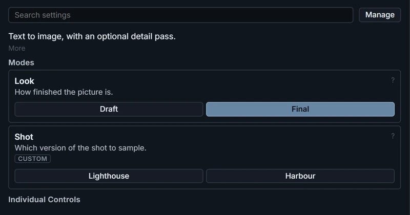
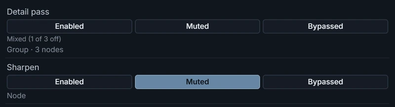
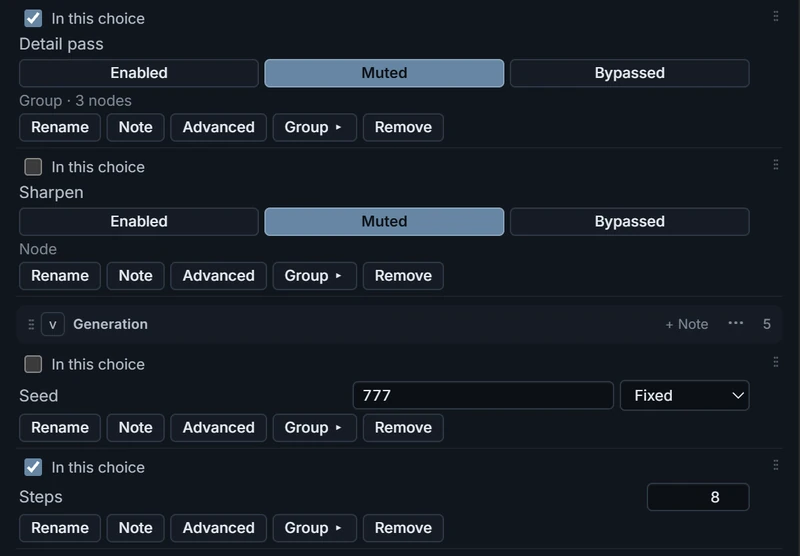

# Controls

Change a workflow's settings — steps, a sampler, a seed, a Selector choice —
from the editor, without going back to the graph. The settings come from a
**Sonder Control Relay** node in the workflow. In the
[Sonder App](#in-the-sonder-app), you can switch between workflows here too.

## Open the Controls tab

In the editor, click the **Controls** tab in the sidebar at the left, beside
**Assets** and **References**.

Under **Individual Controls**, the **Editor** group holds take settings such
as **Takes start muted**. The workflow's notes and settings follow, in the
groups its author chose.

<em>The Editor group, then the workflow's notes and groups.</em>

A workflow without Controls says *No Controls yet*. Click
[Manage](#manage) and add a setting; on the canvas, the editor adds the
**Sonder Control Relay** node to the graph for you (one per workflow).

For a workflow that already has Controls, [Modes](#modes) and notes, open
**Sonder LTX 2.5 Edit & VFX** from [Examples](../README.md#examples).

## Change a setting

Click a value and change it. A seed shows its mode beside it. To read what a
setting does, hold the
pointer over its name: the node's own help appears under it.

A small line near the top of the Controls tab, under the search box (and
under the **Modes** table when the workflow has one), hides what you don't
need:

- **Hide notes** hides the workflow's notes. The line then reads, for example,
  **2 notes hidden**: click it to bring them back.
- Settings the workflow marks Advanced start hidden. The line reads, for
  example, **1 advanced hidden**: click it to show them.
- Both are also checkboxes in **Settings ▸ Controls** (**Show notes** and
  **Show advanced settings**).

Hidden settings still apply their values.

Each take records the values it used. Open the take in **Assets** and look for
**Controls at run** in its details.

A long text setting, such as a song's lyrics, shows only its start under
**Controls at run**. To copy the whole text the run used, click **Copy** on the
value, or right-click it and choose **Copy value**. Gallery search reads only
the start of a long text.

## Modes

A workflow can group whole setups into **Modes**. Each row of the **Modes**
table is a **category**, such as *Task* or *Look*, and its buttons are the
**choices** in it, such as *Text to video* and *Image to video*. One choice
sets several Controls at once, and can switch nodes on and off too: for
example, a **Skip** choice in a *First pass* category that mutes the first
pass's group and sets the second pass's input. A Mode is not a node switch's
**Enabled** / **Muted** / **Bypassed**: those are single
[switches](#switch-nodes-and-groups-on-and-off).

https://github.com/user-attachments/assets/d63c740f-1e94-44c9-806f-bcbe36ec2516

<em>Two categories. <strong>Shot</strong> reads
<strong>Custom</strong> because its seed was changed by hand.</em>

### Use a Mode

1. [Open the Controls tab](#open-the-controls-tab). The **Modes** table is at
   the top, above the **Individual Controls** heading.
2. Click a choice's button. Its Controls change together; Controls outside the
   choice keep their values.

- The highlighted button is the choice whose values the Controls hold now. If
  you change one of those Controls by hand, the category reads **Custom** and
  no button is highlighted.
- A choice can also apply a choice from another category: one click sets both.
- Two outlined buttons with *“A” and “B” both match* need a fix in **Manage**: see
  [Fix a warning in Manage](#fix-a-warning-in-manage).

Each take records its Modes too: in **Assets**, click the take and look for
**Modes at run** in its details. To find takes by Mode, search the gallery for
a category and its choice, for example `field:task=edit`.

To make Modes, see [Make Modes](#make-modes).

## Switch nodes and groups on and off

A workflow can expose a node, a subgraph or a canvas group as a switch with
three buttons: **Enabled**, **Muted** and **Bypassed**. Click one to set every
node it covers, like ComfyUI's own mute and bypass.

<em>A group switch reads Mixed after one of its nodes
was muted through its own switch.</em>

- A group switch covers the nodes inside the group on the canvas at the moment
  you click. When its nodes differ, no button is selected and it reads, for
  example, *Mixed (1 of 3 off)*.
- Two switches can cover the same node (a group and a node inside it). The
  last one you click decides.

To add one, see [Manage](#manage).

## Manage

Click **Manage** at the top right of the Controls tab. Click **Done** to leave.

- **Add a setting:** click **+ Setting** (in the row with **+ Note** and
  **+ Group**), type in **Filter by node or setting**, then click **Add**
  beside the setting. A setting on a node that is off right now isn't listed:
  turn the node on to add it.
- **Add a switch:** click **+ Setting**, then **Add** beside a node, subgraph
  or group under **Nodes and groups**.
- **Bring back removed settings:** **+ Setting → Exposed before → Restore all**.
- **Group and order:** **+ Group** adds a group. Drag a row by its handle to
  reorder it or move it to another group.
- **Notes:** **+ Note** adds a Markdown note. Double-click a note to edit it;
  **Ctrl+Enter** (**⌘+Enter** on macOS) or **Done** saves, **Esc** cancels. A
  note whose first line is bold (`**Before you start**`) or a heading
  (`## Before you start`), with more text after it, collapses: click that line
  to fold or unfold the note. A note can link to any heading of these docs.
- **Workflow description:** up to 1,000 characters of Markdown. The Sonder App
  Launcher shows it beside the workflow.
- **Views:** type over a View's name to rename it (leave it empty for the
  node's title), click **↑** / **↓** to reorder, and **Delete** to remove the
  View (the node stays in the workflow). Each View's **Timing** row says how
  its output follows the timeline: see
  [Following the timeline](generating.md#following-the-timeline). You add
  Views from a viewport pane: see [Output Views](generating.md#output-views).
- **Clean up unavailable…** lists what no longer resolves in this workflow (a
  setting whose node was deleted, saved app values from an older version,
  settings in choices pointing at those) and removes what you leave ticked.

### Make Modes

1. Click **Manage**. The **Modes** section is at the top.
2. Click **+ Category** at the bottom of the **Modes** section. Type its name
   (and a description if you like), then click **Create**.
3. Click **+ Choice** under the category and type the choice's name. Each
   setting and switch in the Controls tab now has an **In this choice**
   checkbox: set each Control to the value this choice should give it, tick
   its **In this choice**, then click **Create**. Add at least two choices.
4. Click **Done**.

<em>Making a Draft choice: it mutes the detail pass
and sets <strong>Steps</strong>; the unticked Controls stay out of it.</em>

To change a choice later, click it in **Manage**. The Controls first take that
choice's values, as its button in the **Modes** table would, so what you see
is what the choice holds. Then:

- **Update from current values** saves what the ticked Controls hold now.
- **Category** moves it to another category, or to **Not in a category**.
- **Also applies**, under **Category**, has one list per other category. Pick
  a choice there to apply it every time this choice is clicked, or **Nothing**
  to stop. For example, open **Upscale Pass Only** and set **“Refine Pass
  Spatial Mask”:** to **Mask Off**: one click then runs the upscale pass with
  the mask off.

Click **Edit** on a category to rename it, change its description or
**Delete** it; its choices stay, under **Not in a category**. Choices **Not in
a category** don't show in the Controls tab.

#### Fix a warning in Manage

**Manage** shows a warning under a category when something needs a fix:

| Warning | Fix |
|---|---|
| *“A” and “B” can both match* | Give the two choices a shared setting with different values, so each is told apart. |
| *Shares Steps with Look* | A choice in one category can change the other. Leave it when that is intended; otherwise remove the shared setting from one category's choices. |
| A choice listed twice, or one that no longer exists | Click **Remove from this category**, **Remove the repeat** or **Remove missing**, or edit that category's choices. |

## Choosing lanes and folders from Controls

The **Sonder Reference Selector**'s lanes, the **Sonder Driver Selector**'s
lane and the **Sonder Save Bridge**'s target folder can be Controls.

1. [Open the Controls tab](#open-the-controls-tab) and click **Manage**.
2. Click **+ Setting**. Type the node's name in **Filter by node or setting**,
   then click **Add** beside `reference_lanes` (Sonder Reference Selector),
   `driver_lane_index` (Sonder Driver Selector) or `target_folder` (Sonder Save
   Bridge).
3. Click **Done**.

The target folder appears in the **Editor** group; the lanes appear with your
other settings:

- **Reference lanes:** the selected lanes with their recipe and status. Click
  **×** on a lane to remove it, or **+ Add lane** to pick another.
- **Driver lane:** a menu of the scene's Driver lanes by name.
- **Target folder:** type a folder name and press **Enter** (or click
  elsewhere).

## In the Sonder App

Controls work the same way in the [Sonder App](sonder-app.md), with these
differences:

- **A choice that needs a missing node pack or model file is greyed out.** To
  install it, follow [Install Models and Node Packs](sonder-app-setup.md).
- **Switch workflows:** the **Workflow** menu at the top of the Controls tab
  opens another imported workflow on the same project. The project, scene and
  timeline stay; takes already generating finish with the workflow they
  started with. Star a workflow there, or in the Launcher's **⋮** menu, to
  keep it at the top of both lists.
- **Your values are kept** for each imported workflow.
- **+ Setting** adds an *App only* Control, which never appears on the canvas.
- **Switches** are added on the canvas: **Export (API)** flattens groups and
  subgraphs, so the app can't tell which nodes a switch would cover. A switch
  works only if every node it covers was on when the workflow was exported. To
  hide a switch you don't need, click **Manage**, then **Hide** on its row.
- **Re-importing** a workflow keeps what you changed in the app (values, seed
  modes, app-only Controls, hidden settings, and the categories, choices and
  Views you edited) and takes labels, notes, order and the description from
  the file.
- **Reset to workflow's version** (in a category's or choice's editor) and
  **Reset** (on a View) bring back the imported version.

## Share Controls

- **From the canvas:** save the workflow (it carries the Controls and Modes),
  or use ComfyUI's **Export (API)** for the Sonder App. **Export (API)** leaves
  out nodes that are muted or bypassed, so first turn on every node a switch
  or setting needs.
- **From the Sonder App:** in the Launcher, open the workflow's **⋮** menu and
  click **Export as API**. Hidden entries and your switch states aren't in the
  file: save switch states in a choice first.

Loading an API file on the ComfyUI canvas flattens subgraphs and can lose some
node settings; send the saved canvas workflow too when the recipient uses the
canvas. To reconnect the Controls of an API file loaded on the canvas, see the
next section.

## Reconnect Controls after loading an API file

1. Load the API file on the ComfyUI canvas. On the **Sonder Editor** node,
   select your project, then click **Open Editor**.
2. Open the **Controls** tab. In the notice at the top, click **Restore
   Controls**. (Or, on the canvas, find the **Sonder Control Relay** node,
   searching for **Control Relay** if it is off-screen, and click **Restore N
   Controls from this file**; the editor doesn't need to be open.)
3. If the message says some Controls **need Rebind**, click **Manage**, then
   **Rebind** beside each one and choose its setting.
4. Save the workflow for the canvas, and **Export (API)** again for the Sonder
   App.

Until you restore, the Controls stay missing, including in an API export made
from that canvas. **Exposed before** suggestions aren't restored: add them
again with **+ Setting**.
