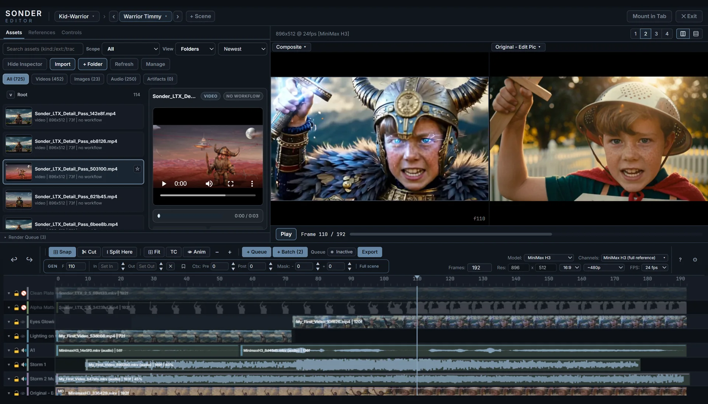
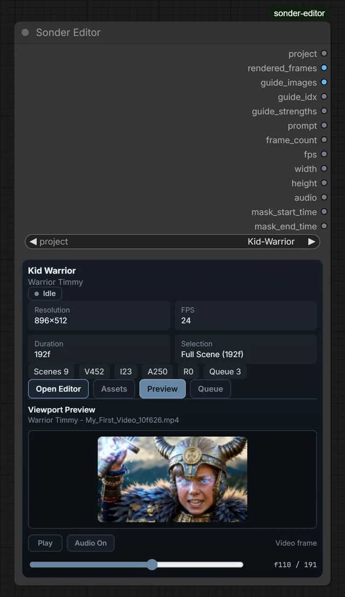
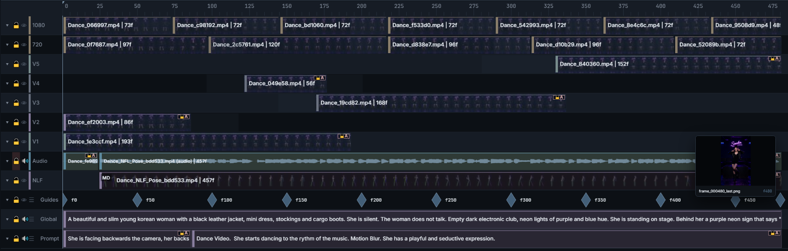

# Editor Basics

How the Sonder Editor surface is organized and how you edit on it: the layout,
the timeline, every item type you can place, and the gestures and shortcuts
that move them around.

This guide covers editing. For selections, prompts, guides, Drivers, templates,
and the render queue, see [Generating](generating.md). For the asset gallery,
inspection, and export, see [Assets & Gallery](assets-and-gallery.md).

## Opening the editor

### The node card

Add the **Sonder Editor** node to your graph: double-click an empty spot on the
canvas, type **Sonder Editor** and pick it. Closed, the node shows a card with
the **project** selector, the project's size, length and selection, and
**Assets**, **Preview** and **Queue** buttons that open small panels without
leaving the graph.

### Fullscreen

Click **Open Editor** on the card. The editor covers the browser window, and
the card shows a placeholder until you click **✕ Exit** at the top right.

### Mount in Tab

**Mount in Tab**, at the top right of the editor, moves the editor into a
browser tab of its own, so the editor and the graph are both in view. Keep the
canvas page open: the tab shows **● Canvas connected** while it can run the
graph, and pauses run controls when the canvas is gone. On the canvas, the
card's button reads **Open Mounted Editor** and brings that tab forward. If the
tab was closed without exiting, click **Force Release** on the card.

## Creating a project

A project is a folder holding its media, scenes and generated takes, under
`ComfyUI/output/sonder-projects/`.

1. On the **Sonder Editor** card, click the **project** selector and choose
   **+ Create New**.
2. Type a name in **project_name** and set **fps**, **width** and **height**.
3. Click **Create**. The card switches to the new project.

To open another project, choose it in the same selector. Inside the editor,
**+ Scene** at the top adds a scene to the project, and the scene pill beside
it switches scenes.

## Screen layout

From top to bottom:

1. **Header bar** — project pill, scene switcher (‹ › and the scene pill),
   **+ Scene**, and **Mount in Tab** / **✕ Exit**.
2. **Top row** — the **Assets | References | Controls sidebar** on the left (Assets keeps
   the **Render Queue** panel docked at its bottom) and the **Viewport** in the center with its
   transport bar (Play, frame counter, clickable progress bar).
3. **Toolbar** — grouped controls: undo/redo, the generation-window block,
   timeline tools, view tools, queue & export, scene geometry, and the
   **?** shortcut overlay and **⚙** Settings buttons.
4. **Timeline** — the multi-lane editing canvas. Inline item editors appear
   directly beneath it.

The sidebar width and timeline height are drag-resizable and remembered
between sessions (**Settings ▸ Layout & UI Scale ▸ Reset Layout Section**
clears them).

**References** is the project-level authoring Library for reusable character,
location, prop, outfit, voice, and video media. The Library holds the media
itself; **Reference lanes** on the timeline are what scope its members over a
range of frames. See
[References](references.md).

## The timeline

### Track order (top to bottom)

1. **Video lanes** (V1, V2, …) — stack for compositing; the higher-numbered
   lane renders in front.
2. **Audio lanes** (A1, A2, …) — independent rows.
3. **Driver lanes** — one Driver clip per lane (conditioning, not output).
4. **Reference lanes** (R1, R2, …) — scope Library members over a range
   (conditioning, not output).
5. **Guides** — a fixed track of guide-frame markers.
6. **Global** — the always-on scene-wide prompt.
7. **Prompt** — the segment prompt-section lane.

### Lane headers

Each media lane header has three independent controls plus the label:

- **▾ Collapse** — folds the lane to make room on the timeline.
- **🔒 Lock** — prevents selecting and editing items on that lane.
- **👁 / 🔊 Hide** — excludes the lane from preview and generation.
- **Label** — drag across headers to select multiple lanes; rename via
  right-click.

Clicking a collapse/lock/hide icon on a selected header applies that state to
every selected lane at once.

The fixed **Guides / Global / Prompt** headers carry a **☰** icon:
**Guide Management** on Guides, and
[Prompt Management](prompts.md#opening-prompt-management) on Global and
Prompt.

### Navigation

| Gesture | Action |
|---|---|
| Wheel | Scroll lanes vertically |
| Ctrl+Wheel | Pan horizontally |
| Shift+Wheel | Zoom |
| Ruler click/drag | Move the playhead |
| Drag empty timeline space | Box-select items |
| Drag across lane headers | Select lanes |

## Item types

### Video clips

A video or image asset on a video lane. Lanes composite top-down with
per-clip opacity. Click selects (a linked clip selects its whole group);
double-click isolates one item and opens its inline editor (start, opacity,
visibility, fit mode). Drag moves, edge-drag trims, and dragging onto an
occupied lane of the same type swaps lanes with the displaced item. Clip
starts clamp to the scene; tails may overhang.

Each clip has a **fit mode** for when its aspect ratio differs from the
scene: *Fit (black bars)*, *Fit (edge pad)* (default — pads by replicating
the source edge), *Fill (crop)* with a crop anchor, or *Stretch*.

### Audio tracks

An audio asset, or the sound of a video, on an Audio row, drawn with its
waveform. Move, trim, split and mute work as for video clips; double-click
opens its start, volume and mute.

Where to drop an audio file or a video's sound is in
[Dropping assets onto the timeline](#dropping-assets-onto-the-timeline). Keep
one copy of a sound; placing it twice doubles what you hear. To mute only the
sound of a linked clip, see [Linked groups](#linked-groups).

### Guide frames

A reference image keyed to one frame on the Guides track, used for generation
conditioning and as the viewport animatic. A guide "holds" until the next
guide (or scene end). Create one by dropping an image on the Guides track,
using **Add Frame to Guides** on a clip (captures the clip's frame at the
playhead), or from Guide Management. Guides have a strength (0–1) and can be
muted, replaced in place, or re-keyed.

### Driver clips

A Driver uses a clip to steer generation without appearing in the output.
To create one, right-click a Video clip and choose **Convert to Driver**.
To show it as footage again, right-click it and choose
**Convert to Render Clip**. For the graph connections, follow
[Drive with a control video](getting-started.md#drive-with-a-control-video).

Each Driver lane holds one clip. Drivers appear in **Animatic** preview;
they cannot be split. Use separate lanes for separate conditioning sources.

### Reference items

A [Reference item](references.md#reference-lanes) places Library members over
a range of frames. Drag to move it; trim its edges to change the range.

Create one by dragging a Reference from the **References** sidebar onto the
timeline. Dropping on the **ruler** always makes a new lane; dropping on an
existing lane stages into it, and is refused with a message if that lane is
locked, already occupied at that frame, or holds the other media kind. Stage
image/video references separately from voice-reference audio — a mixed
selection is refused before the drag starts.

An expanded Library card also offers **Add to timeline**, which stages at the
playhead on the first compatible lane, making a new one only if none fits.

Lane rules, recipes, and what a lane resolves to for a generation window are in
[References](references.md).

### Prompt sections

A text range on the Prompt lane. A section holds until the next section
starts, and its fields come from the project's **Channel Template** — a new
project starts on **Standard**, one plain text field, while other templates
split it into labelled channels or a model's own field set. Double-click
empty lane space to create one; double-click a section to edit its text
inline. The lane is no-overlap: drags abut neighbors or swap with the hovered
section. How sections compose into the generation prompt, and which templates
exist, is covered in [Prompts](prompts.md).

### The Global prompt

The **Global** bar spans the whole scene and can't be moved or split. Its text
goes in front of every Prompt section's text: put what holds for the whole
scene there (style, place, characters), and what happens at a moment in a
Prompt section. Double-click the bar and type. There is no **Create** button:
Global keeps your text when you press Enter or click elsewhere, and **Esc**
discards what you typed.

### Linked groups

Any mix of items can be linked into a **symmetric edit group** (badge letter
A…Z): move, delete, split, and mute act on the whole group and refuse
atomically if any member is locked. Single-click selects the whole group;
**double-click isolates one member** for properties such as volume or
opacity, while mute still affects the group. Video+audio drops and generated
takes auto-link (configurable in Settings). Right-click **Unlink Linked Items**
before muting only one member.

## Editing gestures

- **Snapping** (`S` to toggle, or the **Snap** button above the timeline)
  pulls a dragged item's start **or end**, and a trimmed edge, to nearby
  clip, audio, prompt and Reference item edges, guides, the playhead, In/Out
  and the scene's ends, with a dashed snap guide line where it lands. When
  several items move together, the one you grabbed and the outer edges of
  the group snap. The distance (in frames) and each kind of target are in
  **Settings** (the gear at the right of the timeline toolbar) ▸ **Timeline
  Behavior**. Two more switches there are off by default: **Snap Playhead on
  the Ruler** pulls the playhead to those targets when you click or drag on
  the ruler, and **Snap Razor Cuts** moves a Razor cut to a target inside
  the item you click. Because the distance is in frames, it reaches further on screen
  when you zoom in; press `S` to scrub or cut freely.
- **Razor mode** (`C`): click a clip, audio track, prompt section or Reference
  item to split it at that point (with **Snap Razor Cuts** on, at the snap
  guide shown while you hover, when a target is close). **⌇ Split Here** does the same to everything
  selected, at the playhead. Both cover the same four item types, and both say
  why when something cannot be cut — an item the frame falls outside, a locked
  lane, or a Driver clip. Split Here acts only on the **selection**: with
  nothing selected it tells you so rather than cutting whatever happens to sit
  under the playhead. Splitting several items at once is one undo step.
- **Muting** (`M`): mutes/unmutes the selected items. Mute is per-item render
  participation and composes with lane Hide.
- **Deleting** (`Del`/`Backspace`): deleting the last item on a video/audio
  lane also removes the now-empty lane.
- **Undo** (`Ctrl+Z` / `Ctrl+Y`) covers timeline mutations broadly. Text
  fields keep native text undo; a committed Apply is one undoable step.

### Dropping assets onto the timeline

Where you drop a gallery asset decides what happens:

- **The ruler strip** (the frame numbers at the top) → always a **new row**.
  A video → a Video row; audio → an Audio row; a video with sound → both,
  linked. This is the only drop that places picture and sound together.
- **An existing row** → that row only. A video with sound on a **Video** row
  places the picture; on an **Audio** row, the sound. Audio on a Video row is
  refused.
- **The Guides track** → an image dropped there becomes a guide frame.
- Locked lanes, overlaps, and dead space refuse with a toast pointing at the
  ruler gesture. A type-aware highlight always shows where the drop will land.

## The viewport

The center panel previews the scene at the playhead: all visible render clips
composite in lane order, guide frames render beneath video as an animatic
layer, and Driver clips are excluded so preview matches what actually
renders.

- **Animatic mode** (`A`) hides all video lanes so you see only guides and
  Driver reference playback.
- **Playback preferences** (loop selection, auto-scroll, return-to-start,
  playback resolution) are personal and live in Settings ▸ Playback.
- Heavy scenes rebuffer adaptively: if decoding falls behind, playhead and
  audio pause together and resume in sync.

## Safety & recovery

- Asset deletes route to a **Trash** first; permanent deletion is
  confirmation-gated; deleting an in-use asset warns with its usages.
- **Missing files** show placeholders while references stay recoverable —
  **Relink** restores them (see [Assets & Gallery](assets-and-gallery.md)).
- Saves are **version-checked**, so edits made during a long render or export
  merge instead of overwriting each other.
- Locked lanes and items make destructive actions refuse atomically.

## Keyboard shortcuts

Press **?** in the editor for this list in-app. Shortcuts never fire while
you're typing in a text field.

### Playback

| Key | Action |
|---|---|
| Space | Play / Pause |
| ← / → | Frame back / forward |
| Shift+← / → | 10 frames back / forward |
| Home / End | First / last frame |

### Selection

| Key | Action |
|---|---|
| I / O | Anchor/set In / Out at the playhead (template-snapped) |
| X | Clear selection |

### Tools & editing

| Key | Action |
|---|---|
| C | Toggle razor / cut mode |
| M | Mute / unmute selected item(s) |
| S | Toggle snapping |
| T | Toggle timecode display |
| A | Toggle animatic mode |
| F | Fit timeline to view |
| Shift+F | Zoom to selection |
| + / − | Timeline zoom |
| Del / Backspace | Delete selected items |
| Ctrl+Z / Ctrl+Y / Ctrl+Shift+Z | Undo / Redo |
| ? | Shortcut overlay |
| Esc | Exit fullscreen / dismiss overlay / clear selection |

Gallery, inspect-overlay, and focused Reference-media shortcuts are listed in
[Assets & Gallery](assets-and-gallery.md).
