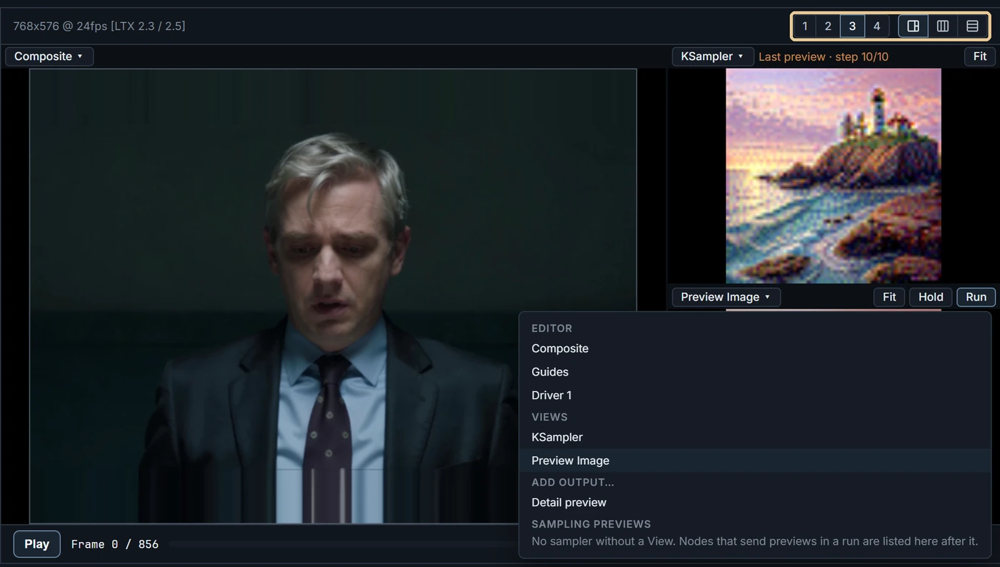

# Generating

How the editor talks to your generation workflow: what you select, what your
model is told, what gets queued, which of your later edits still affect a
queued job, and how to watch the workflow's outputs in the viewport.

Editing itself is covered in [Editor Basics](editor-basics.md); assets and
export in [Assets & Gallery](assets-and-gallery.md).

## What your model needs

<a id="model-agnostic-capability-bounded"></a>
Sonder Editor works with any model: editing, prompting and queueing never touch
one, and generation runs in your ComfyUI graph. What the editor hands your
graph is useful only if the model can act on it:

| If you want to… | Your model needs… |
|---|---|
| Chain clips into long-form video, or regenerate/inpaint a section inside existing footage | **Masked (in-context) generation** — the ability to hold provided frames fixed and generate the rest |
| Drive video from audio, or audio from video | **Joint audio-video generation** |
| Interpret timed Prompt sections within one generated clip | **A compatible prompt format or time-varying conditioning path**; compiling sections into text alone does not guarantee frame-exact changes |
| Use Drivers — unrendered video clips that steer motion, composition, look, or characters | **Video conditioning inputs** for that kind of signal |
| Use References — reusable characters, locations, props and voices, staged per window | **Reference image, video or audio inputs** — a dedicated reference slot, or any image input that will take an assembled sheet |
| Use guide frames | **Image conditioning at arbitrary frames** |

For example, the showcase workflows use **LTX 2.3**, which covers most of
these in one model, and **MiniMax H3**, which has dedicated reference inputs.
[Model templates](../README.md#models) also ship for Wan, HunyuanVideo,
CogVideoX and others, and **No Model Template** removes every constraint for
anything else.

## The generation window

The **Selection** is the **In**–**Out** range you set. The **generation
window** is what a render covers: the Selection plus any context frames. Both
are set in the **GEN** box of the toolbar, which also shows their frame counts.
Moving the playhead (the **F** field, or clicking the ruler) doesn't change
either.

- **Selection (In/Out)** is the live range a render executes. No selection
  means **Full scene** — renders and queues then cover the
  whole scene. Committed In/Out values snap to the active template's frame
  grid; the ▲▼ steppers move directly along it.
- **Context frames (Ctx Pre/Post)** extend the source window beyond the
  selection, feeding your graph already-rendered frames for generation
  overlap — this is what makes seamless chaining possible.
- **Mask offsets (Mask −/+)** move the start and end of the region the
  Masks Bridge marks for regeneration. Check the mask against your intended
  edit before running; these values do not change In/Out.
- **Saved Selections** (the bookmark button) capture the *full* recall state
  — in/out, context, and mask offsets — and live in the project, so they're
  shareable.
- **✕** in the **GEN** box clears the Selection (the **X** key does too).

### Ways to set In and Out

- **Type** a frame in **In** or **Out** and press Enter. The fields accept
  arithmetic (`120+48`), and **TC** in the toolbar (or **T**) switches them to
  seconds.
- **At the playhead:** click the ruler, then press **I** for In or **O** for
  Out.
- **From an item:** right-click a clip, an audio track or a Prompt section and
  choose **Set Selection to Clip**, **Set Selection to Audio** or **Set
  Selection to Prompt**.
- **From guides:** right-click a guide for **Set Selection In** or **Set
  Selection Out** at its frame, or **Select Guide Range**.
- **From a saved selection:** click the bookmark in the **GEN** box.

### Empty timeline means black frames

The editor always hands your workflow real frames. Where the timeline has
no visible content, those frames are **black** — an empty range isn't
"nothing," it's black video. That matters for denoise strength, in any
diffusion workflow:

- A workflow that **fully denoises** its generation window (denoise 1.0,
  as in masked/in-context generation or a plain T2V pass) generates freely
  there — the black source is discarded.
- A workflow that **partially denoises** (vid2vid-style strength below
  1.0) preserves part of its source signal — over an empty range that
  source is black, and the result gets pulled toward it.

Rule of thumb: first passes over empty timeline need a full denoise;
partial-strength passes belong on ranges that already have content.

## Model templates

A **model template** is a named set of constraints for a target model, chosen
in the toolbar's scene-geometry group.

- **Hard constraints snap**: dimension step/offset, the frame rule
  (e.g. LTX's `8n+1`), and the allowed-FPS list.
- **Soft constraints only advise**: recommended/max resolution and a
  recommended duration band show a **⚠** hint when exceeded but never clamp
  your values.

The built-in templates are listed in the [README](../README.md#models). Manage
them in **Settings ▸ Model Templates**: create custom templates, edit any
built-in (with reset), and pick the default for new projects. Custom templates
are saved in your browser, so a project opened on another computer without
your custom template uses **No Model Template**.

Switching to a template with a different frame rule clears **In** and **Out**;
a template with the same rule keeps them. Queued jobs keep the template they
were queued with.

When your generation window does not land on the frame rule, the editor rounds
**up** rather than trimming your selection, and fills the extra frames itself:
video holds the last frame, audio mirrors the end of its own window. Those
frames are left out of the take placed on the timeline, but they are inside the
generated file.

## Prompts

The Global document and every prompt section in the generation window compile
into the one prompt a job carries. Composition, Channel Templates, prompt
formats, Context chips, and the Prompt Management panel are covered in
[Prompts](prompts.md).

## Guides

Guide frames condition generation with a reference image at a specific frame
(and double as the viewport animatic — see
[Editor Basics](editor-basics.md#the-viewport)).

- Each guide has a **strength** (0–1) and a mute toggle; muted guides are
  skipped everywhere.
- **Guide Management** (☰ on the Guides header) lists every guide with
  re-keying, strength, mute, in-place image replacement, and deletion.
- **Add Frame to Guides** on any clip captures that clip's frame at the
  playhead as a new image asset + guide.
- **Settings ▸ Guides ▸ Collision Auto-Offset (project-wide)**, on by
  default, moves a single-image guide off a frame a Driver already uses (for
  LTX-style workflows).
- Guides reach a graph two ways, and you pick one. The editor node's
  `guide_images` output carries every guide in the window as a single IMAGE
  batch, with `guide_idx` and `guide_strengths` as lists aligned to it, for a
  consumer that takes them all at once. **Sonder Guides Bridge Start / End**
  instead wrap your generation body in a loop and emit one guide per pass, for
  a consumer that takes a single guide per call. Do not inject the same project
  guides through both.

## Drivers

[Convert a Video clip to Driver](editor-basics.md#driver-clips) from its
right-click menu. The original video remains an asset, but the Driver is no
longer a visible picture layer. To exclude an old Driver from this workflow's
guidance, hide its **Driver lane** with the eye icon at the left of that row.
This does not hide a separate Audio lane. Collapse only folds the row; it does
not disable guidance. A workflow's explicit Driver override can take priority
over lane hiding, so check the selected workflow's instructions.

Driver clips steer motion, composition, look, or characters without ever
appearing in output (their editing rules are in
[Editor Basics](editor-basics.md#driver-clips)). Each Driver has a
**strength** (0–1). In the graph, **Sonder Driver Selector** picks a Driver
row from its lane menu and outputs `has_driver`; **Sonder Driver Bridge**
outputs that row's frames for the generation window. When the template's frame
rule adds frames to the end of the window, a Driver that runs to the window's
end holds its last frame over them.

## References

Reference items stage Library members — characters, locations, props,
voices — over frame ranges, and reach the model as media assembled by the
lane's recipe plus prompt text derived from those members (authoring is in
[References](references.md)). Each item has a **strength** (0–1) and a mute
toggle, and for any generation window each lane resolves which of its items
applies. The nodes that carry them into a graph are in
[References › Wiring the nodes](references.md#wiring-the-nodes).

## Wiring your graph

The **Sonder Editor** node has only outputs. Apart from the project fields on
its card, its widgets are set by the editor.

| Output | Type | What it carries |
|---|---|---|
| `project` | SONDER_PROJECT | A handle to the project. Every other Sonder node takes this. |
| `rendered_frames` | IMAGE | The timeline's own frames for the generation window. |
| `prompt` | STRING | The compiled prompt for that window, chips resolved. |
| `audio` | AUDIO | The mixed timeline audio for that window. |
| `guide_images` | IMAGE | Every guide frame in the window, as one batch. |
| `guide_idx` / `guide_strengths` | STRING | Comma-separated frame positions and strengths, aligned with that batch. |
| `frame_count` · `fps` · `width` · `height` | INT · FLOAT · INT · INT | The window's geometry, for your sampler and latents. |
| `mask_start_time` / `mask_end_time` | FLOAT | Where the regenerated span begins and ends. |

A text-to-video graph needs three of them and no bridge nodes:

```
Sonder Editor ──prompt────────> your text encoder ──> sampler ──> VAE Decode
              ──frame_count───>                                        │
              ──width/height──>                                        ▼
                                                               Sonder Save Video
```

End every graph with **Sonder Save Video** (or **Sonder Save Bridge**) taking
`project` from the editor, so results come back to the project. The
connection can pass through other project-carrying Sonder nodes, such as
**Sonder Metadata Collector**.

Add bridge nodes only for what your graph uses: guides (**Guides Bridge
Start/End**), masks (**Masks Bridge**), timed prompts (**Prompt Relay
Bridge**), Drivers (**Driver Selector/Bridge**) and References
([Reference Selector and Bridges](references.md#wiring-the-nodes)). The full
node list is in the [README](../README.md#nodes).


<p align="center"><em>The graph above, built on the canvas. Your graph can be
as small as editor → sampler → Sonder Save Video.</em></p>

### Masking an audio-video latent

To regenerate only part of a clip while keeping the context frames, the Masks
Bridge can build the noise masks itself. Encode the editor's frames and audio
into an AV latent, split it, mask each half, and rejoin:

```
VAE Encode (editor frames + audio)
  -> Concat AV Latent -> Separate AV Latent
       video_latent -> Set Latent Noise Mask (mask <- bridge video_mask)
       audio_latent -> Set Latent Noise Mask (mask <- bridge audio_mask)
  -> Concat AV Latent -> sampler
```

Wire each latent, and the VAE that encoded it, back into the Masks Bridge — it
needs **both** to build that channel's mask. The pixel-to-latent geometry comes
from the VAE itself, so it is correct on LTX, MiniMax H3 and Wan without any
per-model setting. What is *not* universal is composition — see the last two
notes below.

For a spatial edit, also follow [Edit a moving region](#edit-a-moving-region).

- **Freeze** emits an all-zero mask, so that channel is kept from source. This
  is how you regenerate audio over locked picture, or the reverse. A frozen
  channel keeps the rounded-up filler too, so if the window had to be rounded
  to the frame rule, its last fraction of a second is editor-generated rather
  than timeline content. Freeze is not the only way that happens - a window
  with post-context keeps the filler on both channels - so treat the filler as
  something the model sees, not something it replaces.
- Wire only half a pair and that channel emits a keep-everything mask and logs
  a warning. A latent that was not encoded from this generation window is refused
  outright rather than masked at the wrong scale.
- The two mask outputs are **not** interchangeable. Video is a batch with one
  entry per latent frame; audio is a single image whose time axis differs by
  model. Swapping them resizes silently instead of erroring.
- Masking only one stream leaves the other fully regenerated, because **Concat
  AV Latent** fills an absent mask with all-ones. Mask both, or Freeze the one
  you want kept.
- **Without spatial_mask, on LTX with guides or a start image, use
  `LTXVAudioVideoMask` (kjnodes) instead of Set Latent Noise Mask.** A spatial
  edit uses a different video writer, described in
  [Edit a moving region](#edit-a-moving-region). Drive `LTXVAudioVideoMask`
  from this node's four *time* outputs rather than the MASK outputs, and place
  it **before** the guide chain:

  ```
  Separate AV Latent -> LTXVAudioVideoMask -> [guide chain] -> Concat AV Latent
                          max_length: partial     <- NOT the default
                          video_start/end_time, audio_start/end_time <- bridge FLOATs
  ```

  It writes the 5D noise mask that LTX's own nodes expect, so `LTXVAddGuide`
  *extends* it rather than colliding with it, and the guides keep their claims.
  Two things to get right: `max_length` defaults to `truncate`, which slices the
  latent and destroys the guide tail — set it to `partial`; and place it before
  the guide chain, because afterwards it either loses your context or silently
  rewrites guide strengths.

  The cost is that you retype `video_fps`, and the node is LTX-only — its 8
  frames-per-latent and 25 audio-latents-per-second are hardcoded, so it is
  wrong on Wan and on MiniMax H3. **Keep the MASK outputs and Set Latent Noise
  Mask for H3 and Wan**, which have no such conflict.

  What goes wrong if you use Set Latent Noise Mask anyway on LTX: those nodes
  read the mask through one helper that expects the 5D form, while ComfyUI's
  `SetLatentNoiseMask` stores 4D. Before `LTXVAddGuide` that raises
  `IndexError: tuple index out of range`. Before `LTXVImgToVideoInplace` it is
  **silent and total** — that node writes over the leading latent frames, but on
  a 4D mask that axis has length one, so it overwrites the entire mask and
  nothing generates at all. After the guide chain the guides are discarded when
  your window reaches the end of the clip, or survive with a silently shifted
  window when it does not. MiniMax H3 is exempt throughout, because its guide
  node returns only conditioning.
- **Without spatial_mask, a mask replaces, it never composes.** Anything that
  already wrote a `noise_mask` upstream loses it — including start-image and continuation nodes
  such as `WanImageToVideo`, `WanAnimateToVideo`, the Cosmos image-to-video
  pair, HunyuanVideo's *v2 (replace)* mode and SCAIL continuation, all of which
  pin their reference frames that way. Those pins are silently destroyed.
  Chaining through the Sonder timeline is unaffected, because it carries context
  as encoded frames inside the window rather than as a producer-written pin.
  Stock `SetLatentNoiseMask` behaves identically; this is not specific to the
  Masks Bridge.
- Without spatial_mask, masks are hard 0/1, so the boundary latent is fully
  regenerated and the seam is a hard cut at latent resolution — around a third of a second for LTX
  video, and much finer for audio.

### Edit a moving region

On **Sonder Masks Bridge**, connect a MASK batch to **spatial_mask**. Supply one
mask for every Editor frame at the generation window's exact width and height,
including pre-context, post-context and padding. The Sonder Editor's
**rendered_frames** output has exactly that length and size, so a mask made
from it fits. A mask that covers only part of the window, such as one made
from a short Driver segment, must be extended to the full window upstream,
normally with black frames. White permits generation inside the edit window,
black protects, and grey limits strength. Author inversion, growth or
feathering upstream.

Connect the window's encoded video latent to **video_latent** and the VAE that
encoded it to **video_vae**. Spatial edits support native LTX video VAEs and
MiniMax H3 video VAEs, including Sol, as long as the loaded VAE includes its
encoder. A still mask for a longer window, a cropped or resized source, an
unsupported VAE, or a boundary inside a latent frame produces an error with
the expected geometry. When a boundary is off-grid, choose the matching
[model template](#model-templates), **LTX 2.3 / 2.5** or **MiniMax H3**, in the
toolbar's scene-geometry group.

The Bridge takes the maximum mask value across each latent frame's pixel-frame
group, then averages each latent cell: 32 pixels square on LTX and 16 on
MiniMax H3. A cell that a region only partly covers turns grey, so the edge of
a region is partly regenerated. To edit or protect an area completely, grow it
upstream by one cell: 32 pixels on LTX, 16 on MiniMax H3. **Freeze** keeps video protected. Audio still
uses its own **edit_audio** setting and **audio_mask** output.

- **LTX** — connect **video_mask** to **masks** on **LTXV Set Video Latent Noise
  Masks** from ComfyUI-LTXVideo. Connect the separated video latent to that
  node's **samples**, then send its output through Guides before sampling.
  Apply this video mask once. A later mask setter can replace both the region
  and Guide pins. Connect **audio_mask** to **mask** on a **Set Latent Noise
  Mask** whose **samples** is the separated audio latent, then rejoin both with
  **Concat AV Latent**. Skipping the audio setter regenerates all audio, even
  with **edit_audio** on Freeze.
- **MiniMax H3** — connect **video_mask** to **mask** on **Set Latent Noise Mask**,
  with the separated video latent connected to **samples**. Apply **audio_mask**
  to the audio latent with a second setter, then rejoin with **Concat AV Latent**.

If the incoming video latent already carries protection, the spatial Bridge
limits its result with those pins. On LTX, an existing full-size 5D mask needs
an isolated writer branch. Feed the original latent into the Bridge. Add
**Latent From Batch**, set **batch_index** to **0** and **length** to **1**, and
connect the original latent to its **samples** input. Connect its copied output
only to the LTX setter's **samples** input. This prevents the setter from
rewriting the original pins and blocking a different region on the next run.
An encoded latent without a stored mask can go straight to the setter.

A sampler's output keeps the mask it was sampled with. If a second pass at the
same size feeds the Bridge a sampled latent, the first pass's region becomes a
pin, and the second edit happens only where the two regions overlap. To edit a
different region, encode the frames again for the second pass.

**LTXV Set Video Latent Noise Masks** cannot expand compact pins such as
`[1,1,T,1,1]` while writing a spatial mask, and a Latent From Batch copy keeps
that compact shape. Apply the Bridge's mask to a branch with the same samples
and no stored mask, while the Bridge still reads the protected original. **Set
Latent Noise Mask** stores a 4D mask and is incompatible with LTX Guide
consumers.

## The render queue

The queue panel docks at the bottom of the Assets sidebar.

- **+ Queue** freezes the current generation window into a job (see the next
  section for exactly what freezes). No selection queues the full scene.
- **+ Batch (N)** splits the selection into contiguous chunks sharing a batch
  id; chunk size follows the template's frame rule and **Max frames per
  batch** (**Settings ▸ Render**). With zero context the chunks are independent; with context, later
  chunks read earlier chunks' placed takes.
- **Queue Active** decides what a ComfyUI run renders: **ON** → the first
  pending queued job (FIFO, one per run); **OFF** → the live editor
  selection.
- Job completion is owned by the terminal save node (**Sonder Save Video**
  or **Save Bridge** with `mark_queue_complete` on). If a batch chunk fails,
  later chunks in that batch are auto-skipped so a progressive batch can't
  continue over a gap.
- New takes land on the timeline as described in
  [Takes](assets-and-gallery.md#takes).

## What's frozen vs. what stays live

Queuing takes a **snapshot**. Knowing what's inside it tells you which later
edits affect a queued job and which don't.

### Frozen into the job at queue time

| Snapshotted | Detail |
|---|---|
| **Selection range** | In/Out (or the full scene if nothing was selected) |
| **Context frames** | pre + post as set at queue time |
| **Mask offsets** | mask − / mask + values |
| **Guides** | every guide in the window: image, frame, strength, mute state |
| **Prompts** | prompt text, format, resolved Context chips and Prompt Relay sections |
| **References** | the winning Reference inputs, their fitting settings and H3 input order, when used |
| **Drivers** | Driver clip snapshots and lane configuration |
| **Scene geometry** | width, height, FPS at queue time |
| **Model template** | the selected template and its frame rule |
| **Take placement mode** | trimmed/untrimmed, per job |
| **Keep take padding** | on/off, per job |

### Still live at execution time

| Live | Consequence |
|---|---|
| **Render clips & audio tracks** | trims, moves, mutes, and lane hides apply as they are when the job runs — the timeline state at execution is what renders |
| **Newly placed takes** | with context, later batch chunks read earlier chunks' takes through the normal compositor |
| **Guides-Bridge per-guide overrides** | the bridge node's override map is read at execution, not from the snapshot |
| **Take link/mute settings** | resolved from live Settings when the take is placed |
| **Asset gallery state** | folders, favorites, renames never affect queued jobs |

Rules of thumb:

- Edit **conditioning** (guides, prompts, References, Drivers, geometry, template)
  *before* queueing — those are locked per job.
- Clips and audio are read when the job runs. Muting, moving or trimming
  content inside a pending job's window changes what it receives. Leave that
  content in place until the job finishes.
- The queue row always shows the frozen range/context/mask.

## Output Views

A **View** is one of your workflow's output nodes (**Preview Image**,
**Sonder Preview Video**, **Sonder Save Video** and the like, including ones
inside a subgraph) shown in a [viewport pane](editor-basics.md#panes). To add
one, click a pane's source button, choose **Add output…** and click the node.
To rename, reorder or delete Views, see [Manage](controls.md#manage).

https://github.com/user-attachments/assets/36622192-fcac-4ed8-ad8b-bae93cbb3303



### The View pane

A View pane shows the newest result of its output node. Its bar has:

- **Run**: runs just that output's branch of the graph, not the whole
  workflow. **Cancel** takes it off the queue or stops it while it runs.
- **Hold**: keeps the result you are looking at when the output runs again.
  **Release** follows the newest again. Hiding the pane releases it too. To
  compare before and after, show the same View in two panes and hold one.
- **◀ 1/3 ▶**: steps through several images.
- **Fit** / **Fill**: shows the whole output, or fills the pane. The mouse
  wheel zooms toward the cursor and dragging pans, as in
  [the inspect overlay](assets-and-gallery.md#the-inspect-overlay).
- **Unmute** (**Listen** while the pane is linked): hear this pane instead of
  the timeline. Only one source plays sound at a time; **Mute** gives the
  sound back to the timeline.
- **Link** / **Linked**: on video and audio outputs. See
  [Following the timeline](#following-the-timeline).

The text beside the source button says what is happening:

| Text | What it means |
|---|---|
| **No result yet** | No run started here has made this output yet. Click **Run**, or run the workflow. |
| **Running** / **Waiting for run** | A run that makes this output is queued or in progress. |
| **Previous result · Running** | A new run has started; the picture is still the last result. |
| **Last run was canceled** / **Last run failed** | The run ended before this output was made. |
| **From cache** | ComfyUI reused an earlier result instead of running the node again. |
| **Switched off** | The node is muted or bypassed; the last result stays. |
| **Didn't run:** and the reason | **Run** couldn't start, for example because another output is waiting for ComfyUI. |
| **This View is no longer in the workflow** | Its node was deleted. Pick another source, or delete the View in **Manage**. |
| **Disconnected** | In a mounted tab: the canvas page is closed or reloading. |

### Following the timeline

A video or audio View pane can play and scrub with the editor, so you can
compare it with the **Composite** frame by frame. **Linked** on the pane's bar
means it does; this is on by default. Click it to read **Link** and play the
output on its own again.

While linked, the pane's own play button and scrub bar are hidden, and the
editor's **Play**, the playhead and the timeline move it:

- **A take** from **Sonder Save Video** that was placed on the timeline
  follows the frames its take clip covers.
- **Any other output** follows the **Timing** you set for its View. Open the
  **Controls** tab, click **Manage**, and find the View's **Timing** row under
  **Views**:
  - **Follows from the render start**: the output's first frame is the first
    frame the Editor rendered, context included.
  - **Follows from the generation start**: the output's first frame is the
    first frame of your selection.
  - **Skip first**: drops that many frames from the start of the output.
  - The frame-rate box: leave it empty when the output has the scene's frame
    rate; otherwise type its rate.
  - **No timing set** leaves the output unlinked.

What a linked pane shows:

| Text | What it means |
|---|---|
| **Outside generated range** | The playhead is outside the frames this output was made for. The picture comes back when the playhead returns. |
| **Catching up** | The pane fell behind (slow decoding) and is catching up. |
| **Previous context** | The scene changed inside this output's range after it ran, so it may no longer match what is around it. **Undo** of the change clears it. |
| **Unlinked:** and the reason | The pane can't follow: for example, the output was made for another scene or frame rate, or its View has no **Timing** (**No timing for this output. Set it in Manage ▸ Views**). |

A linked pane sounds only while the editor plays inside its range.

### Sampling previews

A sampling View shows the picture a sampler draws while it runs, the same one
ComfyUI shows on the sampler node. To set one up, see
[Watch a sampler while it runs](getting-started.md#watch-a-sampler-while-it-runs).

A pane's source button lists, under **Sampling previews**, the workflow's
**KSampler**, **KSampler (Advanced)**, **SamplerCustom**,
**SamplerCustomAdvanced** and KJNodes **Model Preview Override** nodes, plus
any other node that sent previews in a recent run (marked **Sent previews in a
recent run**).

A sampling View has no **Run**: run the workflow as usual. The pane shows the
newest preview, with **Fit** / **Fill**, wheel zoom and drag to pan. For a
moving preview of a video model, see
[Watch a sampler while it runs](getting-started.md#watch-a-sampler-while-it-runs).

The text beside the source button says:

| Text | What it means |
|---|---|
| **Sampling · step 12/30** | The sampler is running; the picture is its latest step. |
| **Last preview · step 30/30** | The sampler finished; this was its last picture. |
| **Running** / **Waiting for previews** | The run started, and no preview has arrived yet. |
| **Previous run · Running** | A new run has started; the picture is still the last run's. |
| **From cache** | ComfyUI reused the sampler's earlier result, so the picture is from the run that made it. |
| **No previews** and the reason | Previews were off for the run (set **Live preview method**; for the Sonder App, start ComfyUI with `--preview-method auto`), the node came from ComfyUI's cache, or a **Model Preview Override** on the sampler's model took them (add a View on the Override node instead). |
| **Last run was canceled** / **Last run failed** | The run ended before the node sent a preview. |
| **Not in the newest run** (added to the text) | Your last run didn't include this node, so the picture is from an earlier one. |
| **Switched off** | The node is muted or bypassed; the last picture stays. |
| **Unavailable** | The preview is no longer kept, or is too large to show here. |
| **Unsupported** | Your browser can't show this preview's format. |
