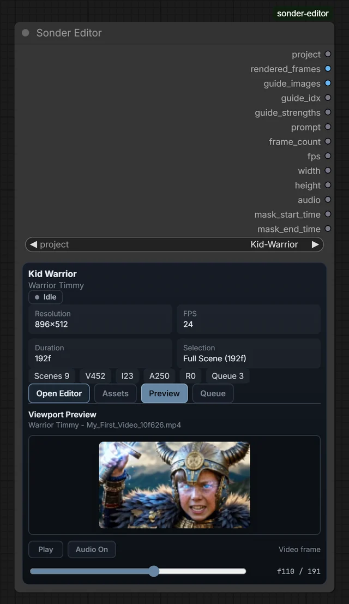
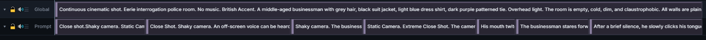
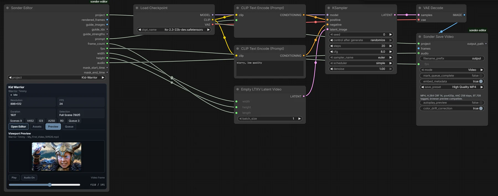
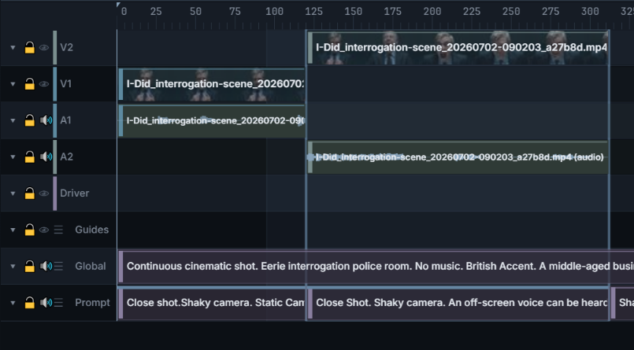
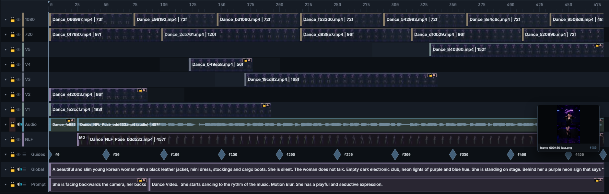

# Getting Started

Choose the route that fits your goal. Both lead to the same timeline editor.

| Your goal | Start here |
|---|---|
| Use a workflow someone has already prepared | [Use a prepared workflow](#use-a-prepared-workflow) |
| Wire the editor into your own ComfyUI graph | [Build a workflow](#build-a-workflow) |

First [install the node pack](../README.md#installation). Each workflow also
needs its own node packs and model files. A **Model template** sets frame and
size rules; it does not install or load those models.

## Use a prepared workflow

Get the workflow and its requirements from its author. The
[example workflows](../README.md#example-workflows) are ready-wired canvas
graphs.

Choose one way to open your workflow below. Sonder App is optional and
experimental; using a prepared workflow on the canvas does not require it.

### Open the prepared workflow on the canvas

1. Drop its **canvas/UI workflow JSON** onto the ComfyUI canvas. Install the
   workflow's required nodes and models before continuing.
2. Find the **Sonder Editor** node. On its card, choose your project, or
   **+ Create New** to create an empty one. A supplied workflow may remember
   its author's project: choose the project you intend to work in.
3. Click **Open Editor** on that card. To keep the graph beside the editor,
   click **Mount in Tab** in the editor's top bar; keep the canvas page open.
4. Continue with [Make and review a first take](#make-and-review-a-first-take).

### Open the prepared workflow in Sonder App

1. Follow the one-time [Sonder App setup](../README.md#sonder-app-experimental).
   Its entry is **Settings → Sonder App (experimental)**, at the bottom of
   Settings. Then click **Open Launcher** there.
2. In the Launcher, click **Import** in the Workflows area and select the
   workflow's **API JSON**. This is a different file from a canvas/UI JSON.
   Resolve any **Missing nodes** or model requirements listed for it.
3. Click **New project** in the project grid to make an empty project, or
   select an existing project. For a new one, enter **Project name** in the
   dialog and use **Create** or **Create and open**, as shown.
4. Select the project **first**, then select the intended workflow: selecting
   a project can restore its last-used workflow. Click **Open** in the bottom bar.
   If creation already opened the editor, continue there.
5. Continue with [Make and review a first take](#make-and-review-a-first-take).

### Make and review a first take

Use an empty scene for this first text-to-video pass. To edit existing footage,
follow the selected workflow's input instructions instead.

1. Open **Controls** at the upper left. If it has **Preset**, choose the
   workflow's text-to-video preset. In LTX 2.5 Edit this is **Make a New Video**.
   A preset sets only its own settings; check its description and sound options.
2. In the toolbar above the timeline, choose the **Model** template matching
   the workflow. Set **Res**, **FPS** and **Frames** to a small supported
   example. For the LTX 2.5 Edit candidate, a first preview can use
   **896 × 512**, **24 FPS** and **17 Frames**.
3. At **Channels** in the same toolbar, use **Standard** for one plain prompt
   field unless your workflow requires another template. This choice is
   project-wide. Double-click empty space on **Prompt**, near the bottom of
   the timeline, enter your description, and click **Create**. Double-click
   **Global** above it only if you also want scene-wide text.
4. Set **In** and **Out** above the timeline to the short range you want to
   generate; press Enter after each typed value. For the 17-frame LTX preview,
   use **In 0**, **Out 17**, **Ctx: Pre 0**, **Post 0** and **Mask −/+ 0**.
   The playhead alone does not select a range. With no selection the whole
   scene generates. Check the frame-count readout after setting the range.
5. Open **Render Queue** in the sidebar and turn **Queue Active** off. In
   Sonder App, leave the take count beside **Generate** at **×1** and click
   **Generate**. On the canvas, use ComfyUI's **Run** button. An empty timeline
   needs a workflow configured to generate freely over its black input frames;
   use its text-to-video preset rather than a partial-strength video edit.
6. A **take** is one generated version. If the workflow saves as a take, a
   new clip appears on the timeline. Click **Play** below the preview, inspect
   the motion and listen to any sound. If the take starts muted, right-click
   its clip and choose **Unmute**; linked picture and sound change together.
   The workflow can expose this preference as
   **Controls → Editor → Takes start muted**.
7. To try another version, change your prompt or exposed Controls and generate
   another short take. [Compare](assets-and-gallery.md#compare-mode) results
   in Assets. Favoriting a result does not make it the active timeline picture.
   Mute competing takes or put the chosen one in front; check playback again.
8. Click **Export** above the timeline to save the arranged scene or selection.
   Choose the range, include the intended picture and sound, and use
   **Compatible MP4** for ordinary playback. See
   [Export timeline](assets-and-gallery.md#export-timeline).

Continue with [Editor Basics](editor-basics.md) for locations and gestures,
[Generating](generating.md) for range/context behavior, or your workflow's guide
for a particular editing task.

## Build a workflow

This route is for wiring your own generation graph. If you already have a
finished graph, use the [prepared-workflow route](#use-a-prepared-workflow).
The numbered sections below retain the original tutorial's link destinations.

### 1. Install the pack

Follow the [README installation steps](../README.md#installation)
(ComfyUI-Manager, or git clone + `pip install -r requirements.txt`), then
restart ComfyUI.

### 2. Add the node and create a project

Add the **Sonder Editor** node to your graph (search "Sonder"). The node
shows a compact card with a project selector. Type a name and create your
first project — every project is a self-contained folder (media, scenes,
cache) under ComfyUI's output area, in `sonder-projects/`.

Click **Open Editor** to enter the fullscreen editing surface.

> **Prefer to explore a finished project first?**
> Open [**Project Sample — LTX 2.3**](https://huggingface.co/datasets/SonderSaid/Sonder-Editor-Projects#project-sample--ltx-23)
> on Hugging Face. Its **Project-Sample** folder includes
> four scenes with media, prompts, guides, and generated takes. The project entry
> includes the matching workflow and opening instructions.

### 3. Pick a model template

In the toolbar, choose the **model template** matching the model your
workflow uses (e.g. **LTX 2.3 / 2.5**) — the editor then snaps frame counts and
dimensions to what that model expects and warns when you exceed its
comfortable ranges. Set the scene's resolution, FPS, and duration in the
same toolbar group. No matching template? Use **No Model Template** and
manage constraints yourself, or create a custom one in Settings.
[Why templates matter →](generating.md#model-templates)

### 4. Write your prompt

For a first text-to-video run, the scene can stay empty — no media needed.

- Double-click the **Global** lane at the bottom of the timeline and write
  the scene-wide text: style, world, characters.
- Double-click the **Prompt** lane below it to create a section and
  describe what happens.

That's a complete T2V setup. Sections hold until the next section starts,
so one section covers the whole scene — add more later to
[direct different moments](prompts.md).

### 5. Choose what to generate

Start with a short **In/Out selection** above the timeline. Move the
playhead, then press **I** and **O**, or type the two frame values and press
Enter. With no selection, the **full scene** renders. For this first pass,
set **Ctx: Pre** and **Post** to **0** and leave **Mask −/+** at **0**.
Check the resulting frame count against your workflow's limits before running.
[Selections, context and model padding](generating.md#the-generation-window).

### 6. Wire the handoff

Back on the ComfyUI canvas (Exit fullscreen, or use
[Mount in Tab](editor-basics.md#mount-in-tab) to keep both visible), wire
the Sonder Editor node's outputs into your generation workflow, and end the
chain with a **Sonder Save Video** node so results register back into the
project.

<em>The showcase pipeline — your graph can be as small as
editor → sampler → Sonder Save Video, and grow bridges as you need
them.</em>

Prefer to start from a finished graph? Download the
**[Sonder LTX 2.3 Playground](../example_workflows/sonder_ltx_2_3_playground.json)**
and drop it onto the ComfyUI canvas — it wires prompt relay, multi-pass
upscaling, image guides, and driver-controlled generation already.

### 7. Run it

Turn **Queue Active** off in the editor's **Render Queue** panel, then click
ComfyUI's **Run** button. The editor hands your window — geometry,
prompt, and (empty) timeline — to the workflow; when **Sonder Save Video**
finishes, the result comes back as a project asset and, as a **take**,
lands on a fresh lane on your timeline.

> Your sampler should run a **full denoise (1.0)** for this first pass — an
> empty timeline renders as black frames, and only a full denoise generates
> freely over them
> ([why →](generating.md#empty-timeline-means-black-frames)).

Click **Play** below the preview and inspect the result before requesting
another take. Use [Compare mode](assets-and-gallery.md#compare-mode) to review
alternatives. Make the chosen take visible on the timeline before
[exporting it](assets-and-gallery.md#export-timeline).

### 8. Bring in media

Everything past pure T2V starts with assets. Drag video, audio, or image
files (or a whole folder) from your file manager into the **asset gallery**
on the left — originals are copied into the project, so it stays portable.

Drag an asset from the gallery onto the **ruler strip** at the top of the
timeline to give it a new lane (a video with sound creates linked
video + audio lanes). Trim by dragging clip edges, split with razor mode
(`C`). Existing footage, your kept takes, guide images, and Drivers all
combine on the same timeline.

### 9. Where to go next

- **Generate without the canvas** — the experimental
  [Sonder App](../README.md#first-generation-in-the-sonder-app) runs the same
  steps from its own page, with a **Generate** button.
- **Write in more fields** — the default is one plain prompt box. A
  [Channel Template](prompts.md#channel-templates) splits it into Visual /
  Speech / Sound, or into a model's own fields.
- **Draft a whole scene at once** —
  [Writing mode](prompts.md#the-prompt-management-panel) turns one continuous
  draft into timed sections.
- **Generate longer sequences** — chain windows with context frames, or
  stage many jobs at once with the [render queue](generating.md#the-render-queue).
- **Regenerate part of a clip** —
  [mask a window](generating.md#masking-an-audio-video-latent) so the frames
  around it are kept exactly.
- **Condition harder** — [guide frames](generating.md#guides),
  [Drivers](generating.md#drivers), and time-aligned
  [prompt sections](prompts.md).
- **Reuse characters and places** — build a
  [Reference Library](references.md) and stage its members over a range.
- **Review and finish** — [compare takes](assets-and-gallery.md#compare-mode)
  side by side, then
  [export the timeline](assets-and-gallery.md#export-timeline).
