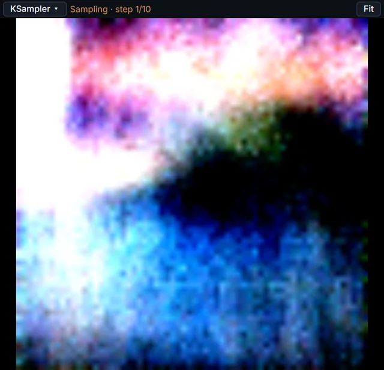

# Getting Started

Step-by-step instructions for common goals, with any model. Each goal gives the
editor steps, then what your graph needs for it. First
[install the node pack](../README.md#installation). For a ready-made graph, see
[Examples](../README.md#examples).

| Goal | Your model needs | Steps |
|---|---|---|
| Generate a clip from a prompt | Text-to-video | [Make a first take](#make-a-first-take) |
| Continue a clip past its end | Masked (in-context) generation | [Extend a video](#extend-a-video) |
| Generate long-form video in seamless chunks | Masked (in-context) generation | [Generate long-form video](#generate-long-form-video) |
| Regenerate a section of a clip | Masked (in-context) generation | [Redo a part of a clip](#redo-a-part-of-a-clip) |
| Set keyframes at any point in your video | Image conditioning at chosen frames | [Guide with frames](#guide-with-frames) |
| Steer a generation with a control video (pose, depth, edges, style…) | A video control input | [Drive with a control video](#drive-with-a-control-video) |
| Use your own character or place | An image (or audio) reference input | [Use a Reference](#use-a-reference) |
| Use several References as separate inputs | Separate reference inputs (MiniMax H3, for example) | [Use References with separate inputs](#use-references-with-separate-inputs) |
| Watch the picture form while a sampler runs | Nothing: any sampler | [Watch a sampler while it runs](#watch-a-sampler-while-it-runs) |
| Save the finished scene as a file | Nothing: no graph runs | [Export the timeline](#export-the-timeline) |

## Make a first take

**Goal:** generate a five-second clip from a prompt and see it on the timeline.

**Your model needs:** text-to-video, in a ComfyUI graph that already runs.

**In the editor:**
1. On the ComfyUI canvas, double-click an empty spot, type **Sonder Editor**
   and pick it.
2. On the node, click the **project** selector and choose **+ Create New**.
   Type a name in **project_name**, set **fps**, **width** and **height** to
   values your model supports, then click **Create**.
3. Click **Open Editor** on the same node.
4. In the toolbar above the timeline, set **Model** to your model's
   [template](generating.md#model-templates), or **No Model Template** if none
   matches.
5. Double-click the **Global** bar in the timeline and type what holds for the
   whole scene (style, place, light). Press Enter or click elsewhere to keep it;
   **Esc** discards what you typed.
6. Double-click empty space on the **Prompt** row, the last row of the
   timeline. Type what happens, then click **Create**.
7. In the **GEN** box of the toolbar, type `0` in **In** and press Enter, then
   about five seconds of frames in **Out** (for example `121` at 24 fps) and
   press Enter.
8. In the same box, set **Ctx: Pre**, **Post** and both **Mask** fields to `0`.
9. At the bottom of the **Assets** sidebar, click **Render Queue** to open it
   and untick **Queue Active**.

**In the graph:**
1. Encode **Sonder Editor**'s `rendered_frames` (and `audio`, for a model that
   generates sound) with your model's VAE, and sample that latent instead of an
   empty one. Wire `prompt` into your text encoder. If your graph can only start
   from an empty latent, wire `frame_count`, `width` and `height` into it
   instead.
2. Sample at full denoise: an empty timeline reaches the graph as
   [black frames](generating.md#empty-timeline-means-black-frames).
3. End the graph with **Sonder Save Video**, with `project` wired from the
   editor and your decoded frames in `frames`. Set **mode** to **Take**. To keep
   the generated sound too, wire your audio into `audio` and leave
   **place_audio_on_timeline** on.
4. Click **Run** at the top right of the canvas. In the
   [Sonder App](sonder-app.md#generate), click **Generate** instead.

**You'll see:** a new [take](assets-and-gallery.md#takes) on its own Video row,
with any sound on a linked Audio row, covering **In** to **Out**. Click **Play**
under the preview to watch it.

**Learn more:** [The generation window](generating.md#the-generation-window) ·
[Wiring your graph](generating.md#wiring-your-graph) ·
[Prompts](prompts.md) ·
Worked example: the [LTX 2.3 Playground](../README.md#examples) does this with
its **Sonder Selector** on **LTXV Scheduler - First Pass**.

## Extend a video

**Goal:** continue a clip past its last frame.

**Your model needs:** [masked (in-context) generation](generating.md#what-your-model-needs),
so it keeps the frames it is given and generates the rest.

**In the editor:**
1. Put the clip on the timeline. For a file: drag it from your file manager
   into the **Assets** sidebar, then from **Assets** onto the ruler (the strip
   of frame numbers at the top of the timeline). It lands on a new Video row.
2. Click the ruler near the clip's end. Use **←** / **→** to land on the first
   frame after the clip, where the preview turns empty, and press **I**.
3. If the scene ends there too, type a longer length in **Frames** (toolbar,
   right side) and press Enter.
4. Click the ruler where the new part should end and press **O**.
5. Set **Ctx: Pre** to how many of the clip's last frames the model should see,
   for example `24`. Set **Post** to `0`. These are the
   [context frames](generating.md#the-generation-window).
6. Write a **Prompt** section over the new range (double-click the **Prompt**
   row, type, **Create**).
7. In **Render Queue**, untick **Queue Active**.

**In the graph:**
1. Encode `rendered_frames` (and `audio`) as in
   [Make a first take](#make-a-first-take).
2. Add **Sonder Masks Bridge**, with `project` from the editor, so only the new
   frames are generated. Two ways to use it:
   - wire each latent and the VAE that encoded it into its `video_latent` /
     `video_vae` (and `audio_latent` / `audio_vae`), and feed its `video_mask`
     and `audio_mask` outputs into **Set Latent Noise Mask** on each latent;
   - or feed its four time outputs (`video_mask_start_time` …
     `audio_mask_end_time`) into your model's own mask node. On LTX with guides,
     use this route; see
     [Masking an audio-video latent](generating.md#masking-an-audio-video-latent).
3. On **Sonder Masks Bridge**, set **edit_video** to **Edit**. To generate new
   sound too, set **edit_audio** to **Edit** and leave **Sonder Save Video**'s
   **place_audio_on_timeline** on. To keep the clip's sound, set **edit_audio**
   to **Freeze** and turn **place_audio_on_timeline** off.
4. **Sonder Save Video**: **mode** **Take**. Click **Run**.

**You'll see:** a take that starts at **In** and continues the clip's motion.

**Learn more:** [Dropping assets onto the timeline](editor-basics.md#dropping-assets-onto-the-timeline) ·
Worked example: the [LTX 2.3 Playground](../README.md#examples) wires the Masks
Bridge times into `LTXVAudioVideoMask`.

## Generate long-form video

**Goal:** generate long-form video in chunks that join seamlessly, rendered one
after another.

**Your model needs:** [masked (in-context) generation](generating.md#what-your-model-needs),
as in [Extend a video](#extend-a-video).

**In the editor:**
1. In the sidebar at the left, open the **Controls** tab. In its **Editor**
   group, set **Max frames per batch** to the longest chunk your computer
   renders reliably, context frames included, for example `121`.
2. In the same group, untick **Takes start muted**, so each chunk's take is the
   source for the next ([Takes](assets-and-gallery.md#which-takes-should-start-muted)).
3. Set **In** and **Out** to the range you want, or click **✕** in the **GEN**
   box to use the whole scene.
4. Set **Ctx: Pre**, for example to `24`, and **Post** to `0`.
5. Click **+ Batch (N)** in the toolbar: *N* chunks appear as jobs in
   [Render Queue](generating.md#the-render-queue).
6. In **Render Queue**, tick **Queue Active**.

**In the graph:**
1. Wire **Sonder Masks Bridge** as in [Extend a video](#extend-a-video).
2. On **Sonder Save Video**, turn **mark_queue_complete** on, so each run
   finishes its job and the next run takes the next one. Keep **mode** on
   **Take**.
3. Type the number of jobs in the box beside **Run**, then click **Run**.

**You'll see:** each run renders the next job and marks it **Completed** in
**Render Queue**; **Clear Completed Renders** removes finished jobs. The takes
line up one after another across the range.

To queue several takes of one selection instead, click **+ Queue** once per
take, and set your seed to change on each run.

**Learn more:** [What's frozen vs. what stays live](generating.md#whats-frozen-vs-what-stays-live)

## Redo a part of a clip

**Goal:** regenerate a section of a clip and keep the frames around it.

**Your model needs:** [masked (in-context) generation](generating.md#what-your-model-needs).

**In the editor:**
1. Click the ruler where the section starts and press **I**. Click where it
   ends and press **O**.
2. Set **Ctx: Pre** and **Post** to the number of frames to keep on each side,
   for example `24`.
3. Choose how far to change it:
   - **A subtle fix** (a seam, lip-sync): you will sample at partial denoise.
     In the **Controls** tab's **Editor** group, tick **Takes start muted**, so
     every attempt starts from the original.
   - **A new action or line:** you will sample at full denoise; takes can stay
     unmuted.
4. In **Render Queue**, untick **Queue Active**.

**In the graph:**
1. Encode `rendered_frames` (and `audio`) and wire **Sonder Masks Bridge** as
   in [Extend a video](#extend-a-video).
2. Set denoise to match step 3: below 1 for a subtle fix, 1 for a new action.
3. To keep the clip's sound, set **edit_audio** to **Freeze** and turn
   **Sonder Save Video**'s **place_audio_on_timeline** off. To regenerate it
   too, leave both on.
4. **Sonder Save Video**: **mode** **Take**. Change the seed before each new
   attempt, then click **Run**.

**You'll see:** a take covering only **In** to **Out**, on a new Video row in
front of the original. If it starts muted, right-click it and choose **Unmute
Selected** to see it in place.

**Learn more:** [Takes](assets-and-gallery.md#takes) ·
[Compare mode](assets-and-gallery.md#compare-mode) ·
Worked example: for a subtle fix, the
[LTX 2.3 Playground](../README.md#examples)'s **Manual Sigmas - Detail/Upscale
Pass** choice.

## Guide with frames

**Goal:** set keyframes at any point in your video: still images the video
passes through at the frames you choose.

**Your model needs:** [image conditioning at chosen frames](generating.md#what-your-model-needs).

**In the editor:**
1. Drag the images from your file manager into the **Assets** sidebar.
2. Drag each image from **Assets** onto the **Guides** row, at the frame where
   it should appear. Each one is a keyframe, called a
   [guide](generating.md#guides) in the editor.
3. To set an exact frame or a strength, click **☰** on the **Guides** row
   header to open **Guide Management**, and edit that guide's row.
4. Set **In** and **Out** to the range to generate. The guides inside it are
   used at their frames. If your model takes only a first and a last frame,
   start and end the range on guides.
5. In **Render Queue**, untick **Queue Active**.

**In the graph:** use one of the two routes, not both.
- **All guides at once:** wire **Sonder Editor**'s `guide_images`, `guide_idx`
  and `guide_strengths` into a node that takes a batch of guide images with
  their frames and strengths.
- **One guide per pass:** place your model's per-guide node (for example
  `LTXVAddGuide`) between **Sonder Guides Bridge Start** and **Sonder Guides
  Bridge End**, both with `project` from the editor. Feed it Start's `image`,
  `frame_index` and `strength`, carry your latent through the loop's `value`
  sockets, and connect Start's `flow_control` to End.

Then save with **Sonder Save Video**, **mode** **Take**, and click **Run**.

**You'll see:** a take that passes through each image at its frame.

**Learn more:** [Guide frames](editor-basics.md#guide-frames) ·
Worked example: the [LTX 2.3 Playground](../README.md#examples) loops
`LTXVAddGuide` between the Guides Bridges.

## Drive with a control video

**Goal:** steer a generation with a control video (pose, depth, edges, style
and more), without the control video appearing.

**Your model needs:** [a video control input](generating.md#what-your-model-needs)
for that kind of signal, such as an IC-LoRA.

**In the editor:**
1. Drag the control video into **Assets**, then from **Assets** onto the ruler.
   It lands on a new Video row.
2. Right-click the clip and choose **Convert to Driver**. It becomes a
   [Driver](generating.md#drivers): it moves to a **Driver** row and leaves the
   preview.
3. Write a **Prompt** section over the Driver's range.
4. Set **In** and **Out** inside the Driver's range. Keep the range short:
   driven generation is heavier.
5. In **Render Queue**, untick **Queue Active**.

**In the graph:**
1. Add **Sonder Driver Selector** with `project` from the editor, and choose
   your Driver row by name in its lane menu.
2. Wire its `driver_ref` into **Sonder Driver Bridge**, and the Bridge's
   `driver_images` (with `driver_idx` and `driver_strength` if your node takes
   them) into your model's control input.
3. If the Driver covers only part of the timeline, route the driver branch
   through **Sonder Switch** or **Sonder Cluster** on the Selector's
   `has_driver`, so ranges without a Driver skip it, including its LoRA.
4. **Sonder Save Video**: **mode** **Take**. Click **Run**.

**You'll see:** a take that follows the control video.

**Learn more:** [Driver clips](editor-basics.md#driver-clips) ·
Worked example: the [LTX 2.3 Playground](../README.md#examples) drives an LTX
IC-LoRA this way.

## Use a Reference

**Goal:** use your own character, place or voice to condition a generation.

**Your model needs:** an [image or audio reference input](generating.md#what-your-model-needs),
in a graph that already generates. Choose a
[Reference lane recipe](references.md#recipes-and-reference-lane-setup) that
matches what that input accepts.

**In the editor:**
1. Drag your source files into **Assets**. Open the **References** tab at the
   upper left, click **+**, fill **Name** and click **Save**.
2. Click the new [Reference](references.md#reference-library) to expand it,
   then **+ Member**. Click **Image**, **Audio** or **Video**, choose the
   asset with **Select**, fill **Member name** and **Prompt**, then **Save**.
3. Drag the member from **References** onto the timeline ruler to create a
   [Reference lane](references.md#reference-lanes). Move or trim the item to
   cover the range where it should apply.
4. In **Reference Lane Setup**, which opens on the first item, choose
   **Recipe → Template** to match your model's input. If it did not open,
   click **☰** on the Reference lane header.
5. Set **In** and **Out** in the **GEN** box inside the item's range; set
   **Ctx: Pre**, **Post** and both **Mask** fields to `0` for this first run.
   Check that the item reads [In window](references.md#what-a-generation-window-resolves-to).
6. Write the action in a **Prompt** section. To include the Reference's text,
   [attach a Context chip](references.md#attaching-a-context-chip).
   In **Render Queue**, untick **Queue Active**.

**In the graph:**
1. Add **Sonder Reference Selector** and connect **Sonder Editor**'s `project`
   to it. In the Selector's lane list, click **+** and select your lane.
2. Connect `reference_set` to **Sonder Reference Image Bridge** for images,
   or **Sonder Reference Audio Bridge** for audio. Connect `r01` or `a01` to
   your model's reference input; use more outputs if the recipe calls for them.
3. On the Bridge, set **unused_slots** to `nothing` for optional inputs that
   should receive no reference. Use `placeholder` for required inputs that
   need a value. See [unused outputs](references.md#wiring-the-nodes).
4. Connect the editor's `prompt` to your text encoder. If you need the
   recipe text separately, use **Sonder Reference Prompt Bridge** from the
   same `reference_set` and wire `reference_prompt` to the matching text input
   instead of also attaching that text as a chip.
5. For windows without a Reference, use `has_reference` to select the
   conditioned or unconditioned branch with **Sonder Switch** or
   **Sonder Cluster**. Keep the Bridges on the conditional branch so they
   are skipped when `has_reference` is `0`.
6. Save the decoded result with **Sonder Save Video**, `project` from the
   editor and **mode** **Take**, then click **Run**.

**You'll see:** a new [take](assets-and-gallery.md#takes) generated with the
Reference input. How strongly it follows the media depends on your model.

**Learn more:** [Wiring the Reference nodes](references.md#wiring-the-nodes) ·
[Reference prompting](references.md#reference-prompting).
There is no shipped generic Reference example; add these nodes to your
model's working graph.

## Use References with separate inputs

**Goal:** send several References to separate model inputs, with a prompt
that names their roles.

**Your model needs:** [separate reference inputs](generating.md#what-your-model-needs)
and a matching [Slots recipe](references.md#recipes-and-reference-lane-setup).
For MiniMax H3, use its reference-to-video model mode.

**In the editor:**
1. Add your Library members and stage the first as in
   [Use a Reference](#use-a-reference). In **Reference Lane Setup**, expand
   that item's options and click **+ Add member** to include another Library
   member in the same item. Use [separate lanes](references.md#use-cases)
   for different timing or recipes.
2. In each lane's **Reference Lane Setup → Recipe → Template**, select the
   matching slot recipe. For H3 images, choose **MiniMax H3 Pictures**.
   Use **↑** / **↓** beside the staged members to put inputs in the order you want.
3. Choose the appropriate **Channels** template above the timeline. For H3,
   choose **MiniMax H3 (full reference)**, then follow
   [Subject or Picture setup](references.md#minimax-h3-full-reference).
4. Write the action in a **Prompt** section. Attach chips for the sources
   it uses, and fill any fields named by the prompt advisories.
5. Set **In** and **Out**, check which items are **In window**, and untick
   **Queue Active** in **Render Queue**.

**In the graph:**
1. Connect `project` from **Sonder Editor** to **Sonder Reference Selector**.
   Use its **+** lane picker to select the staged lanes. Use separate
   Selectors for incompatible recipes or media kinds.
2. Connect each Selector's `reference_set` to its Image or Audio Bridge.
   Wire the numbered outputs to the corresponding numbered model inputs,
   preserving lane and member order.
3. Set **unused_slots** for required or optional inputs; for H3's optional
   reference inputs use `nothing`. Gate empty Reference branches with
   `has_reference`, as in
   [Use a Reference](#use-a-reference).
4. Connect the editor's `prompt` to the text encoder. For H3, set the
   consuming node's **ref_image_size** to `max`, and use the `ref2va`
   model choice.
5. Save with **Sonder Save Video**, **mode** **Take**, then click **Run**.

<em>The Reference half of an H3 graph, checked with previews
before the model nodes are added. Each Bridge output names the picture it
carries, matching the labels in the prompt.</em>

**You'll see:** a take conditioned by the numbered inputs. The prompt's
Reference labels follow the selected generation window.

**Learn more:** [MiniMax H3 prompting](references.md#minimax-h3-full-reference) ·
Worked example: [Sonder MiniMax H3 References](../example_workflows/sonder_minimax_h3_references.json).

## Watch a sampler while it runs

**Goal:** watch the picture form in the editor, step by step, while your
sampler works.

**Your model needs:** nothing; any graph with a sampler.

**In the editor:**
1. Click **Open Editor** on the **Sonder Editor** node, then
   [Mount in Tab](editor-basics.md#mount-in-tab) at the top right of the
   editor. You will run the graph from the canvas tab.
2. At the right of the bar above the viewport, click **2**. A second
   [pane](editor-basics.md#panes) appears; the first keeps the scene preview.
3. Click the second pane's source button at its top left (**Guides ▾**).
4. Under **Sampling previews**, click your sampler. For a video model, first
   add the Override (In the graph, step 3) and click it instead. It becomes a
   [View](generating.md#output-views), and the pane keeps showing it.

**In the graph:**
1. Make ComfyUI draw previews: open ComfyUI's **Settings** (the gear icon),
   search for `preview`, and set **Live preview method** to **auto**,
   **latent2rgb** or **taesd**. With **default**, ComfyUI draws previews only
   if it was started with `--preview-method`.
2. Sample with one of the samplers listed in
   [Sampling previews](generating.md#sampling-previews); one inside a subgraph
   works too.
3. For a video model, put KJNodes **Model Preview Override** between your
   model and the sampler, and set its `preview_frames` above `1` (for example
   `16`). ComfyUI's own preview shows only a video's first frame; the Override
   then plays frames from across the clip as a short loop.
4. In the canvas tab, click **Run** at the top right.

**You'll see:** the pane's picture sharpen step by step, with **Sampling ·
step 4/8** beside its source button, then **Last preview · step 8/8** when the
sampler finishes.

<em>A sampler's preview in a pane, from the first step to the
last.</em>

**Learn more:** [Sampling previews](generating.md#sampling-previews) ·
[Output Views](generating.md#output-views)

## Export the timeline

**Goal:** save the arranged scene, picture and sound, as one file.

**Your model needs:** nothing; no graph runs.

**In the editor:**
1. Make the version you want visible: right-click each
   [take](assets-and-gallery.md#takes) you don't want and choose **Mute
   Selected**. Click **Play** under the preview to check.
2. To export part of the scene, set **In** and **Out**.
3. Click **Export** in the toolbar.
4. Under **Source**, choose **Full scene** or **Active selection**.
5. Under **Save preset**, choose **High Quality MP4**.
6. Tick **Include video**, and **Include audio** if the scene has sound. Untick
   **Place as take** unless you want the file back on the timeline.
7. Click **Export**.

**You'll see:** a progress bar, then the file in the **Exports** folder of
**Assets**. Double-click it to play it.

**Learn more:** [Export timeline](assets-and-gallery.md#export-timeline)
