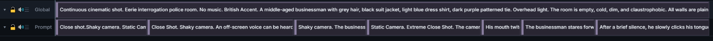
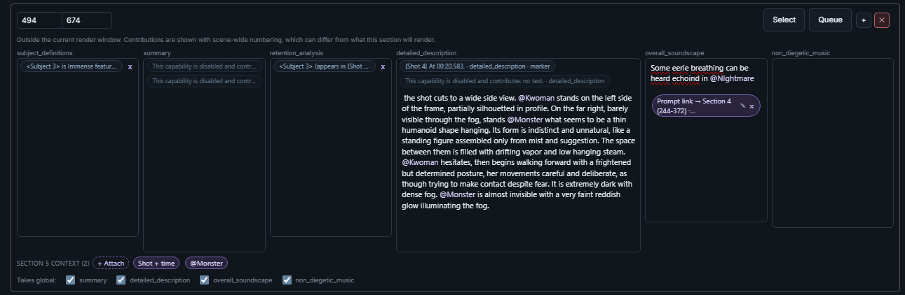
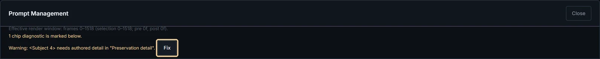
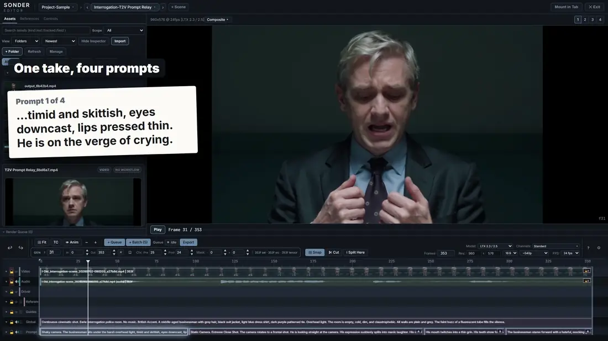
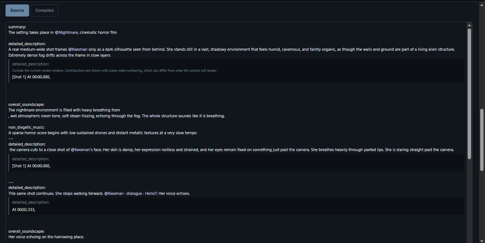
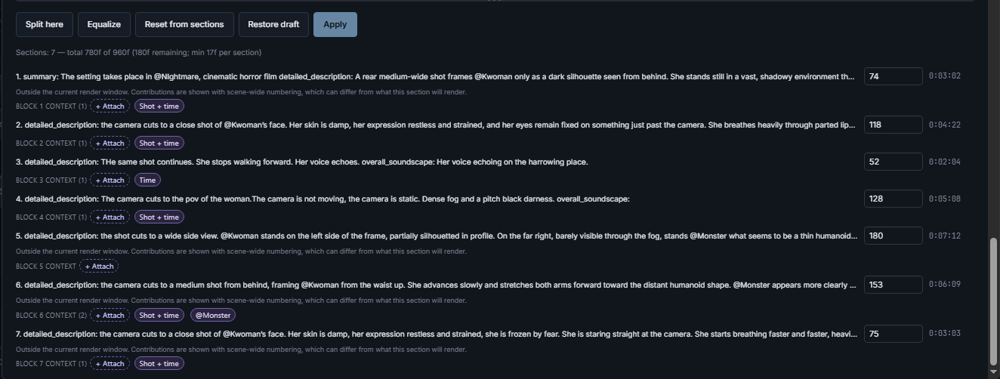

# Prompts

Every render carries one prompt, compiled from what you wrote across the
timeline. Three things decide what that prompt looks like:

| Surface | What it decides |
|---|---|
| **Channel Template** — the toolbar's **Channels** selector | Which fields a prompt section has. |
| **Prompt format** — Prompt Management | How those fields are labelled, separated, and validated. |
| **Prompt sections and the Global document** — timeline | What the fields say, and when. |

Timeline gestures for prompt sections are in
[Editor Basics](editor-basics.md#prompt-sections); how a queued job freezes its
prompt is in [Generating](generating.md#whats-frozen-vs-what-stays-live).
References that feed prompts are in [References](references.md).

## Opening Prompt Management

**Prompt Management** is where you edit every prompt of the scene in one
place, choose the prompt format, and name References and identities. Open it in
any of these ways:

- Click **☰** on the **Prompt** or **Global** lane header of the timeline.
- Right-click a Prompt section, or the Prompt lane, and choose **Open Prompt
  Management**.
- In **Reference Lane Setup**, click an item's prompt preview.

**Structured** and **Writing** switch between its two
[modes](#structured-and-writing-prompt-modes). It also holds **Prompt Context**
(the prompt format),
[Reference Prompting](references.md#reference-prompting) and
[Identity Prompting](#prompt-identities).

## How the output prompt is composed

The **Global** text and every Prompt section in the generation window compile
into one prompt. The **Channels** selector above the timeline sets which fields
a section has. How closely a model follows the sections' times depends on the
workflow and prompt format.

While you edit a section on the timeline, the **Channel** list above its
fields shows **All channels**; choose one to edit only that field. The other
fields keep their text.

- **Boundary Prompt Threshold %** (**Settings ▸ Prompts**, default 10%) leaves
  out a section that only grazes the generation window. Those sections show a
  dim **Ignored** hatch on the timeline. At least one section is always kept.
- **Out-of-window Reference text** (**Settings ▸ Prompts**): see
  [References](references.md#when-the-reference-isnt-in-the-window).
- Lane hiding is part of composition: Prompt lane hidden → global-only
  output; Global hidden → sections only; both hidden → empty prompt.
- **Takes global** (on each section in Structured mode) chooses, per field,
  whether that field adds the Global text.

## Channel Templates

A Channel Template decides which fields a prompt section has. It is
**project-wide**: every section in the project authors the same set.

Choose it in the toolbar's **Channels** selector, or in **Settings ▸ Prompts ▸
Channel Template**. A new project starts on **Standard** (one plain field)
unless you change **Default for new projects** under **Settings ▸ Channel
Templates**.

Built-ins cover the common cases: one plain field, the editor's Visual / Speech
/ Sound split, and MiniMax H3's own field sets. To make your own, open
**Settings ▸ Channel Templates** and click **New Channel Template**. It sets:

- its channels, each with a key, the header written into the prompt, and the
  guidance shown while you write that field;
- **Field names**: **Always write field names** (every channel then needs a
  header) or **Never write field names**;
- **Between fields** and **After a header**: the separators;
- **Shot markers in**: the field that carries shot markers;
- **Unlabelled writing goes to**: where Writing-mode text without a heading lands;
- **Default prompt format**.

Custom templates are saved in this browser. A project keeps a copy of the one
it uses, so it opens elsewhere with its fields. When that copy is older than
your edited template, the template's settings card offers **Use** to update it.

## Prompt formats

Where a Channel Template says what the fields *are*, a **prompt format** says
how they are written: labels, separators, dynamic syntax, writing aids, and what
counts as valid. Error messages call it a "prompt context profile".

Choose a format per scene in Prompt Management's **Prompt Context** section.
Until you choose, a scene uses the format its Channel Template names; once you
choose, the scene keeps your choice. A format built for another template is
listed but disabled.

To change a built-in format, click **Save as custom…** and edit the copy.
Saving an edited custom format creates a new version; select that version
in each scene that should use it.

A custom format lets you choose where chip text appears, its labels and
available choices, the identity kinds and Reference sources it supports,
and its speaker labels.

## Context chips

A chip's text follows the generation window: shot numbers, timestamps,
Reference labels and links renumber when you move things. Two chips that would
write the same line write it once. To leave out one part of a chip's text,
open the chip and untick that part.

**+ Attach** adds one. Chips sit either inline in a field or in the section's own context row, depending on
where the format places them. To change a chip later, click an inline chip
(marked `✎`), or click a context-row chip and choose **Configure…**.

| Chip | What it contributes |
|---|---|
| **Shot** | Shot numbering, with an optional relative time. |
| **Time** | A timestamp on its own. |
| **Reference** | Context for a staged Reference or a prompt identity. |
| **Vocal event** | A managed piece of speech or song. |
| **Prompt link** | A link to an earlier prompt section. |
| **Context** | Your own text. |

Fields following a source appear in a collapsed row naming that source.
Click **Override…** on that row to show and change them. Fields you have
overridden stay visible.

Leave optional fields empty when you have nothing to add. A field following
a source can still contribute that source's text; untick that part in the
chip if you want none. If an advisory names a missing
field, use its **Fix** to open the field and supply the requested detail.

<em>Warnings sit at the top of Prompt Management; <strong>Fix</strong>
opens the chip on the field the warning names.</em>

## Writing aids

Some provider syntax is fixed — a dialogue wrapper, a scene-transition marker, a
camera phrase from a set vocabulary.

A **Writing aid** inserts that syntax for you: right-click in a prompt box (or
press **Shift+F10**) and choose it. Your prompt format decides which aids a
field offers.

Generic formats offer dialogue, voiceover, group speech, singing, scene
transition, cutoff, visible text, camera motion and framing. Some take fields —
dialogue asks for a language, camera motion offers a list of moves — and what
they insert is ordinary text you can edit afterwards.

## Prompt Relay

Prompt Relay lets a supported model use different prompts during one
generation. [Install ComfyUI-PromptRelay](sonder-app-setup.md#ltx-25-edit--vfx),
then add **Sonder Prompt Relay Bridge**, with `project` wired from
**Sonder Editor**.

| Bridge output | Connect to |
|---|---|
| `global_prompt` | The Relay encoder's `global_prompt` input, for scene-wide text |
| `smart_prompt` | **Prompt Relay Encode (Smart)**'s `smart_prompt`, with timed sections |
| `local_prompts` | **Prompt Relay Encode**'s `local_prompts`, for the manual route |
| `segment_lengths` | **Prompt Relay Encode**'s `segment_lengths`, alongside `local_prompts` |

Choose the Smart route or the manual pair. Feed the Relay encoder your model,
CLIP and sampled latent, then connect both its `model` and `positive` outputs
onward to the sampler. Follow ComfyUI-PromptRelay's example for your model, and
don't combine it with other nodes that patch the model's attention.

## Prompt identities

An **identity** is a provider-neutral record of who or what a prompt is talking
about. To create one, open Prompt Management and click **+** beside
**Identity Prompting**. Adding a Library Reference doesn't create one.

An identity may combine several Library members, each with its own contribution,
or exist from a description alone with no media at all. When an audio member is
attributed to one, it declares that identity's voice: that member's prose feeds
the audio definition rather than the appearance.

Identities and Reference members share one set of handles, so `@Anna` reaches
whichever you named.

Identities live under **Identity Prompting**, beside **Reference Prompting** in
Prompt Management. Which identity kinds exist is declared by your prompt format.

For member defaults and staged-item text, use
[Reference Prompting](references.md#reference-prompting). To create an H3
Subject while attaching a chip, follow
[New Subject](references.md#minimax-h3-full-reference).

## Structured and Writing Prompt modes

[Prompt Management](#opening-prompt-management) has two modes. The difference
that matters most is whether they write to your prompts as you type.

### Structured mode — live

Editors for Global and every section, with the same chips as the timeline,
**Select** and **Queue** on each row, **Save Current as Template**, and
**Load History** (the prompts of earlier queued jobs) to re-apply one.

Edits here are edits to the prompts themselves. There is nothing to commit.

### Writing mode — a draft

One continuous chip-aware draft of the whole lane. A line containing only `---`
splits sections, a line like `visual:` starts that channel, and unlabelled text
goes to the template's default draft channel. An allocation strip distributes
frames per block.

Two views share one draft. **Source** is where you write — channel headings,
break lines and chip contributions all editable, with each chip's contribution
shown as prose beneath the text it attaches to. **Compiled** shows, read-only,
the prompt the draft becomes.

**Nothing here reaches your prompts until you Apply** — and nothing your prompts
do reaches the draft on its own either.

- **Apply** replaces the lane's sections with the draft blocks. It means *make
  the lane match this draft*, so it also replaces any section edits made
  elsewhere since you started writing.
- **Reset from sections** pulls the other way, rebuilding the draft and its
  lengths from the lane's current sections. The draft you had is kept, and
  **Restore draft** brings it back.

Alongside those, **Split here** breaks the draft at the caret and **Equalize**
resets every block to an equal share of the scene.

<em><strong>Restore draft</strong> brings back the draft that <strong>Reset from sections</strong> replaced.</em>

Drafts are saved in your browser, per project and scene — not in the project.
They don't travel to another machine, and clearing site data loses them.
