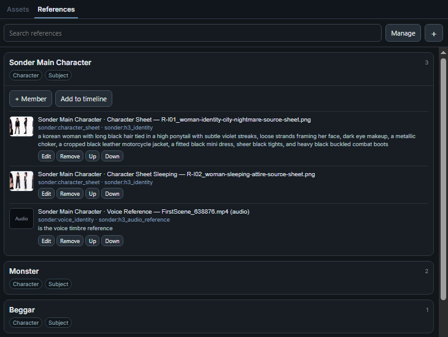
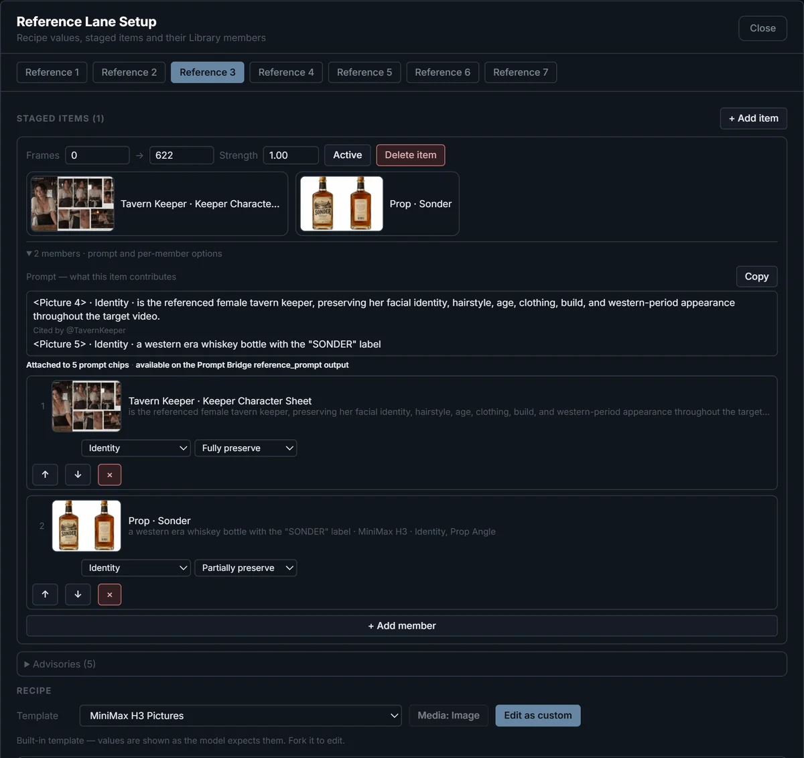
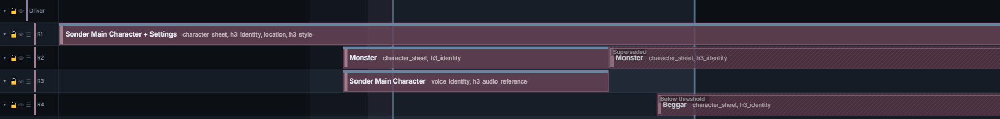

# References

A **Reference** is a reusable piece of a project — a character, a location, a
prop, an outfit — kept in one place and used wherever it applies.

Three surfaces divide the work:

| Surface | What it is for |
|---|---|
| **Reference Library** — sidebar | Registering and managing References and their media. |
| **Reference lanes and recipes** — timeline | When a Reference applies, and how it is served to your graph. |
| **Reference Prompting** — Prompt Management | Naming References in prompts, and deriving text from them dynamically. |

In practice you meet them in that order — who or what it is, when and how it
applies, then what the prompt says about it:

```
1 ── WHO / WHAT ───────────────── Reference Library, sidebar ──

    Anna ─┬─ closeup   image   "a woman in a red coat"
          ├─ sheet     image   "full turnaround, neutral light"
          └─ voice     audio   "low, unhurried"

    One Reference, several members. Each member owns its media,
    its @handle, and its own prompt text.

                 │  drag a member onto a Reference lane
                 ▼

2 ── WHEN & HOW ─────────────────── Reference lane, timeline ──

    the staged item   frame range · strength · Active
    the lane recipe   how the members are assembled, and which
                      Bridge outputs go live

    For a generation window every staged item gets a verdict:
    In window / Superseded / Below threshold / Outside / Excluded

                 │  the winner now serves the graph twice
                 ▼

3 ── WHAT IT SAYS ABOUT IT ───────────────── the prompt text ──

    The recipe composes one string from the members you staged:

        prefix  ·  one expansion per member  ·  suffix

    Attach it as a Context chip, or wire the Prompt Bridge. That
    choice decides which socket below carries it.


── the two servings, converging on your graph ─────────────────

  Sonder Editor ─┬─ project ──> Reference Selector
                 │                      │  one reference_set
                 │          ┌───────────┼───────────┐
                 │          ▼           ▼           ▼
                 │       Image       Audio       Prompt
                 │       Bridge      Bridge      Bridge
                 │       r01..r16    a01..a16    reference_prompt
                 │       └─── the media ───┘     └─ the text ─┘
                 │
                 └─ prompt ───────────────────> the text again, if
                                                you attached a chip
                                                instead — already
                                                compiled in
```

Assets themselves are covered in [Assets & Gallery](assets-and-gallery.md),
timeline gestures in [Editor Basics](editor-basics.md), and generation in
[Generating](generating.md).

## Reference Library

Switch the fullscreen or mounted left sidebar from **Assets** to
**References**.


<!-- The tag picker in this image predates the verified family-grouped UI and remains flagged for later regeneration. -->

- Create a named **character**, **location**, **prop**, or **outfit**, choose
  whether it is a **subject** or **context**, and give it a one-line
  description. Locations begin as context; the other kinds begin as subjects,
  and either can be changed.
- Cards show their kind, class, description, member count, and unresolved
  state. **Manage** reveals entity Edit and Delete.
- Add one image, audio, or video asset at a time. The picker can **Inspect** a
  source without selecting it. After selection, only compatible built-in tags
  are offered; custom tags remain unrestricted.
- Members can carry tags, prompt text, an image/video crop, and an
  audio/video start/end trim. A blank end uses the rest of the source.
- **Crop & Preview**, **Trim & Preview**, or **Crop, Trim & Preview** opens the
  focused visual editor. **Full Source** shows editable crop/trim geometry;
  **Applied Result** shows only the cropped or trimmed result. Audio edits its
  trim on the waveform and seeks on a separate bar; video uses the same
  transport, with a waveform when it has audio.
- Drag a crop's interior to move it, its edges or corners to resize. Choose the
  same ratio presets used by the timeline, **Free**, or **Custom** with a
  width/height ratio such as `3 × 10`. Trim handles resize the interval;
  dragging its middle moves it without changing its duration.
- **Space** plays or pauses the active view, and focused crop and trim controls
  take Arrow-key nudges — the full list is in the editor's **?** shortcut
  atlas. **Apply to Draft** returns your edit to the member; nothing reaches
  the project until you Save.
- **Edit**, **Remove**, and **Up/Down** act on individual members, with explicit
  Save and Cancel. Swapping a member's source asset happens inside its editor.
- Search matches reference names, kinds, descriptions, current asset names, and
  both the stored id and displayed label of member tags. Missing, Trashed, and
  unresolved members stay visible.

## Tags

Tags are how a member says what it *is* — a face close-up, a turnaround, a
voice. They do two jobs.

**They make the Library readable.** A wall of near-identical thumbnails is hard
to scan; tags give each member a label you can search on, alongside names,
kinds, and descriptions.

**They let a recipe ask for what it needs.** Each recipe carries the tags it
works best with, and a lane whose staged members don't include one raises a
suggestion to stage it. LTX Best Face ID asks for a face close-up; MiniMax H3
Pictures asks for identity, environment, style, motion, storyboard, or
composition-anchor inputs. These are suggestions, not requirements — nothing
is blocked, and the only hard limit is the recipe's member cap.

A tag describing content is universal. A tag naming a provider input slot
carries its family: **Motion Reference** is universal, while
**MiniMax H3 · Motion** names an H3 slot. The picker groups tags by family;
compact timeline labels use shorter names, such as **H3·Motion**.
Custom tags keep the text you entered.

Built-in tags are media-aware, so once you pick an asset only the tags that fit
it are offered: Voice Identity takes standalone audio, and video only when the
clip has embedded audio. Custom tags are free text and carry no media rules.

Tags never reach the model on their own. They describe a member and guide
staging; what the model receives is its media and its prompt text.

## Reference lanes

Adding media to the **Reference Library** alone does not send it to a model.
In the **References** sidebar at the upper left, drag the intended member
onto a **Reference** timeline row over the range where it applies. The lane's
recipe and connected workflow decide how that staged input is used. A
Reference guides a generation; it is not a visible Video layer.

A Reference lane holds **Reference items** — ranges saying which Library
members apply over which frames, say this character's face plus this outfit
from frame 0 to 120.

The item points at the Library rather than holding a copy of anything. Edit a
member there and every item using it follows; move or trim an item and you
change *when* those references apply, never the media itself. An item always
carries at least one member, and a blank end runs to scene end.

Each lane holds one media kind, so items can't move between an image lane and
an audio lane. Items on a lane can't overlap. Each item can be muted and
carries its own conditioning strength. The lane header carries the lane name,
with the recipe name beside it when the header is wide enough; item bars show
their member names, then the same tags in compact form.

Create items by dragging from the **References** sidebar onto the timeline, or
with **Add to timeline** on an expanded Library card; the rules are in
[Editor Basics › Reference items](editor-basics.md#reference-items).

A Reference lane header's **☰** (also on its right-click menu) opens **Reference Lane Setup**.
It also opens after the first item is added to a new or empty lane. To turn
that off, open **Settings → References** and untick
**Open Lane Setup on First Item (browser)**.

## Reference image fitting

**Settings → References** sets how individual reference images and video
frames fill their recipe's output dimensions, across all built-in and custom
recipes in the project. New and existing projects default to **Fill (crop),
Center** until you choose a setting.

| Fit Mode | Result |
|---|---|
| **Fit (black bars)** | Keeps the whole image and its aspect ratio, adding black bars. |
| **Fit (edge pad)** | Keeps the whole image and fills the remaining space with its edge pixels. |
| **Fill (crop)** | Fills the output while keeping aspect ratio, cropping what extends past it. |
| **Stretch** | Fills the output by resizing to its width and height. |

Fill also offers a **Crop Anchor**: Center, Top, Bottom, Left or Right. The
anchor stays saved when another mode hides the control. These settings travel
with the project; the clip and guide creation defaults are separate browser
preferences. A choice shows at once while it saves; if the save fails, the
control returns to the saved setting.

Fitting happens after the Library member's own crop and after the recipe
chooses output dimensions. It applies to **Batch**, **Temporal** and **Slots**.
**Sheet** grids and strips keep their recipe's fitting, layout and background.

Queued jobs keep the fit mode and anchor captured when they were added, even
if Settings changes before they run.

<a id="recipes-and-lane-setup"></a>
## Recipes and Reference Lane Setup

A lane's **recipe** decides how its staged members become model input. Open it
from the lane header's **☰**.

Every recipe starts with an **Assembly**, the choice that shapes everything else:

| Assembly | What the model receives |
|---|---|
| **Batch** | Each member stays a separate image, stacked into one batch — a set of identities. |
| **Sheet** | Members are composited into one image, a panel grid or a vertical strip, for models that read a single reference image. |
| **Temporal** | Members are laid out along time, each holding a contiguous run of frames. |
| **Slots** | Each member goes out on its own numbered socket (`r01`, `r02`, …) for models that take separately wired inputs. |
| **Audio** | The member is trimmed audio rather than an image; only the audio outputs carry anything. |

Recipes that ship built in:

| Recipe | Media | Assembly | Members |
|---|---|---|---|
| LTX Multiple Subject Reference | image | temporal | 5 |
| LTX IC-LoRA Ingredients | image | sheet | 16 |
| LTX Best Face ID | image | sheet | 4 |
| LTX ID-LoRA Voice Identity | audio | audio | 16 |
| Wan VACE Reference Sheet | image | sheet | 16 |
| Wan Phantom Identities | image | batch | 4 |
| Wan SCAIL Identities | image | batch | 6 |
| Wan Bernini-R References | image | slots | 8 |
| MiniMax H3 Pictures | image | slots | 9 |
| MiniMax H3 Videos (IMAGE sequences) | image | slots | 3 |
| MiniMax H3 Standalone Audio | audio | audio | 3 |

Choose a recipe in **Reference Lane Setup → Recipe → Template**.
Recipes for a different media kind are greyed out while the lane holds items,
with the reason beside the name. Stage that kind on another lane instead.
A mouse selection applies immediately. When browsing with the keyboard, press
Enter or leave the selector to apply; Esc restores the previous choice.

**Edit as custom** makes an editable project recipe from the selected values.
To reset it to the built-in recipe, select that built-in again in **Template**.

Several model contracts need one extra setup detail outside the recipe:

- **LTX Best Face ID** uses a single-reference frame of `460×406`
  (`1.133:1`). A portrait face crop is therefore pillarboxed to roughly 59–66%
  frame fill unless the Library member's crop box matches that aspect.
- **LTX IC-LoRA Ingredients** needs both `Reference sheet: [...]` and
  `Generated video: [...]`. The recipe supplies both labels — `Reference
  sheet:` as its prefix and `Generated video:` as its suffix — so the derived
  prompt arrives already closed. What is still yours is the generated-video
  description that follows the label, written on the prompt track.
- **MiniMax H3 Pictures** assumes the consuming node's `ref_image_size` is
  `max`. The node defaults to `match`, which rescales to the generation's pixel
  area and discards the recipe's 2048-short-edge preparation. The recipe mirrors
  the node's nearest-`/32` image rounding; set the node to `max` when using it.

**Reference Lane Setup** shows each staged item's frame range, strength,
**Active** state, members and advisories. Tabs along the top switch lanes.
Item options start expanded; fold them when you only need the summary.
Per-member controls include the role and preservation choices offered by the
recipe. The recipe fields below depend on its **Assembly**.

The prompt preview is read-only. Click it to open
[Prompt Management → Reference Prompting](#the-lanes-derived-prompt).


<p align="center"><em>The screenshot shows an older layout. Prompt editing now
lives in Prompt Management → Reference Prompting; click the item's preview
in Reference Lane Setup to open it.</em></p>

Some values are **pegged** rather than typed — the frame grid and snap multiple
follow the scene's model template, a sheet's loop length follows the render
window. A pegged value names the source it follows, and falls back to its
authored number when that source is unset.

Grid sheets choose the column count that gives their actual members the most
fitted image area. Four square members form a `2×2`; four portrait members form
the accepted `4×1` layout rather than reserving empty cells.

## What a generation window resolves to

Staging an item doesn't guarantee the model sees it. For the current generation
window every staged item gets a verdict, shown on the timeline and in
Reference Lane Setup:

| Verdict | Meaning |
|---|---|
| **In window** | This item won on its lane and is available to the graph through a Selector that selects the lane. |
| **Superseded** | Another item on this lane covers this window more tightly, so that one is sent instead. |
| **Below threshold** | The overlap is below the threshold relative to the shorter item/window span, so this item is not sent. |
| **Outside window** | The item doesn't overlap the window. |
| **Excluded** | Muted, or on a hidden lane, so it never participates. |


<p align="center"><em>Only the solid bars reach the model. <strong>Superseded</strong> lost to an item covering the window more tightly; <strong>Below threshold</strong> was dropped because its overlap is too small relative to the shorter item/window span.</em></p>

**Reference Threshold %** (Settings, project-wide) measures overlap divided by
the shorter of the item span and render-window span. An item containing the
window, or fully inside it, scores 100% and stays even at threshold 100.
Crossing an edge reduces coverage smoothly; a short neighbor mostly inside a
long window can still stay. Unlike prompts, filtering can leave a lane with
*nothing*. Lower the threshold or extend the staged range into the window.
If several items pass, the item with the greatest overlap relative to its own
span wins on that lane.

With no selection nothing is marked, since the marks answer "what will this
render use".

Queueing a **batch** predicts all of this per chunk before anything runs, and
says whether a lane drops because of the threshold or because that chunk falls
outside the staged range. A lane that resolves in no chunk always warns.

### Use cases

- **One lane: versions of the same thing.** For example, a character "Before
  Fight" and "After Fight". Stage each version as its own item, one after the
  other on the lane; only one is used at a time. If a generation window spans
  both, only one of them is sent.
- **Separate lanes: things that appear together.** For example, a character
  and a location in the same shot. Give each its own lane and add both lanes
  to the **Sonder Reference Selector**'s lane list. Lanes with different
  recipes need a Selector each.

<a id="prompts-from-references"></a>
## Reference prompting

### Attaching a Context chip

Open [Prompt Management](prompts.md#opening-prompt-management), find the
Global or timed section you are writing, and click **+ Attach**. Choose
**Reference**, choose its source, then click **Attach**. Click the chip's
**✎** to change its fields later.

With **Generic**, the source is a staged Reference item and its chip uses the
[lane's derived prompt](#the-lanes-derived-prompt). With
**MiniMax H3 (full reference)**, choose a Subject or a physical Picture,
Video or Audio source as described [below](#minimax-h3-full-reference).
The chip resolves for the current generation window and contributes to the
editor's `prompt` output.

**Reference Prompting** holds member handles, prompt defaults and staged-item
overrides. **Identity Prompting** holds [prompt identities](prompts.md#prompt-identities).
Adding a Library Reference does not create an identity.

### The Prompt Bridge

To keep the recipe's text separate from the editor's main prompt, wire
**Sonder Reference Prompt Bridge** from the Selector's `reference_set`.
Its `reference_prompt` output carries the combined recipe text; `p01`–`p16`
carry individual member text. Connect the output to your model's matching
text input or combine it with `prompt` before encoding. Avoid adding the
same recipe text through both a chip and the Bridge.

### The lane's derived prompt

A staged item carries prompt text as well as media, assembled from the members
themselves so it tracks what you stage.

For the **Generic** prompt format, open
[Prompt Management](prompts.md#opening-prompt-management) and scroll down
to **Reference Prompting**, in the **Prompt Context** section. Under
**Recipe-derived prompt**, find the staged item's row: **Copy** copies its
derived text; **Edit as override** starts an editable version for that item.
Edit the box and leave it to save; Esc reverts the unsaved edit. **Clear**
removes the override and returns to the recipe's text.

These overrides affect the Prompt Bridge and Generic chips. For
**MiniMax H3 (full reference)**, author the Subject or Picture chip's fields
instead; see [below](#minimax-h3-full-reference).

Three recipe fields shape the derived text:

- **Prompt prefix** — static text placed once at the front, not repeated per
  member.
- **Per-member token** — a pattern expanded once per staged member.
  Use `{n}` for numbering from 1, `{index}` from 0, and `{prompt}` for the
  member's prompt text. `{name}` supplies its prompt-safe `Entity_Member`
  label; `{entity_name}` and `{member_name}` supply the parts separately.

  For example, `Reference {n}: {prompt}` produces
  `Reference 1: a woman in a red coat`. If the pattern contains none of the
  text or name placeholders, the member's text is appended after it. Leave
  the field empty to use the member's text, falling back to its name.

  `{n}` and `{index}` describe positions within the recipe output, not MiniMax
  H3 ordinals. H3 Subject/Picture numbering comes from the recipe's **Model
  input** — Pictures, Videos or Standalone Audio, which the built-in H3 recipes
  already set. Lane order then numbers those slots across lanes, and **Move
  Lane Up** / **Move Lane Down** in the lane header menu renumbers them. A
  Reference Context chip reads the ordinals from the compiled setup, so you
  never count them by hand.
- **Prompt suffix** — static text placed once after the whole thing, for a
  format whose reference block is closed by a second label. LTX IC-LoRA
  Ingredients uses it for `Generated video:`, which leads the prompt you write
  next.

Each per-member expansion also goes out on its own numbered Prompt Bridge
output, so a graph can wire one member's text separately from the aggregate.
The prefix and suffix are not repeated there — they open and close the whole
block, not each member.

### MiniMax H3 (full reference)

MiniMax H3 uses a more complex prompt syntax than other models: the prompt is
split into named sections, and References are named by labels such as
`<Subject 1>`. The editor writes the labels for you; for what each section
should say, read
[MiniMax's full-reference prompt guide](https://huggingface.co/MiniMaxAI/MiniMax-H3/blob/main/docs/VIDEO_PROMPT_WRITING_GUIDE_ref_en.md).

Choose **MiniMax H3 (full reference)** in the toolbar's **Channels** selector.
Check **Prompt Management → Prompt Context** if the scene has an explicit
prompt-format choice; it must use **MiniMax H3 (full reference)** too.

A **Subject** names reusable content: a person, place, outfit or style. It
can draw on several Library members. A **Picture** source names the image
itself, such as a composition anchor. For a character taken from a picture,
attach a Subject and select that picture as its source.

To create a Subject while attaching a chip:

1. In the prompt section, click **+ Attach**, choose **Reference**, then
   **New Subject…** in the source selector.
2. Fill **Name**, **Handle** and **Definition** in the identity editor.
   Expand **Physical sources — optional** and select the Library members
   that supply the Subject.
   Describe the content in **Definition**; source labels are added for you.
3. Click **Use for this attachment** to return to the chip dialog.
4. Set the chip's fields and click **Attach**. The Subject is created with
   the attachment; cancelling before this leaves no new Subject.

To name the Subject in the shot's action, type its `@handle` in the
description, for example `@Anna opens the door.` (see [Mentions](#mentions)).
A chip attached to the section adds no mention to `detailed_description` by
default. To add one, expand **Prompt parts and routing** in the chip dialog
and tick **Scene mention**; leave it off if your text already names the
Subject.

Fill **Preservation detail** with what should carry over, for example
“Keep the coat's red color and the face shape.” If a warning at the top of
Prompt Management names a missing **Preservation detail**, click its **Fix**
to open that chip on the field.
Empty optional fields can stay empty; address the fields named by advisories.

### When the Reference isn't in the window

A chip can name a Reference that doesn't win the current window — its lane is
muted or hidden, its item is superseded, below threshold, or simply outside.
The render still goes ahead, and the chip raises an advisory instead of
blocking the job.

That is what makes a deliberate reference-free pass possible: for a final
low-denoise upscale you mute the Reference lane so nothing influences detail,
and every chip bound to that lane follows the mute. The node path reads the
same fact the same way — a muted lane yields `has_reference = 0`, so the gate
skips the Bridges.

A **deleted** source is a different matter and does block. That is broken
authoring rather than a fact about this window.

What becomes of the chip's own authored text is a policy you choose:

| Policy | What reaches the prompt |
|---|---|
| **Drop** (default) | Nothing. The chip's text stays out of the prompt. |
| **Keep** | The authored text, with no Reference conditioning the render. |

Set it project-wide in **Settings ▸ Prompts ▸ Out-of-window Reference text**.
Any single chip may disagree: its configure dialog carries an **Out-of-window
text** row offering *Project default*, *Drop* and *Keep*, and a chip that
overrides the project shows a small `KEEP` or `DROP` badge. The override is
local to that chip **including linked copies**, so splitting a section leaves
the two halves free to differ.

Keep preserves what *you* wrote, not what the compiler would have claimed for
you. A derived appearance clause such as `(appears in [Shot 3])` follows the
conditioning rather than the prose, so it is not added for a chip that isn't
conditioning the window under either policy.

Advisories aggregate per lane and cause, so muting a lane on a dense timeline
reads as one advisory naming every affected chip. When text is kept a second
advisory says so. Either way every affected chip is still marked individually in the
Prompt Management.

### Mentions

Reference members and prompt identities share one set of **handles**. Typing
`@Anna` in any prompt field compiles to whatever label your prompt format uses,
and the editor marks it so you can see it is live.

Mentions are ordinary text, which is what lets them survive copy, cut, and
paste. Prose can name a handle that doesn't exist yet and wire itself up when
you create it. An unrecognized `@handle` stays as typed and raises a warning: correct its
spelling or create the intended identity/member handle.

Reference **Context chips**, which carry the same intent without typing
provider ordinals by hand, are covered in
[Prompts › Context chips](prompts.md#context-chips).

## Wiring the nodes

Use **Sonder Reference Selector** to choose lanes, then connect the matching
Image, Audio or Prompt Bridge to send their media or text to your model.

```
Sonder Editor ──project──> Reference Selector ──reference_set──> Image Bridge
                                    │                            Audio Bridge
                                    └── has_reference ── gate ──> Prompt Bridge
```

Prefer to start from a finished graph? The
**[Sonder MiniMax H3 References](../example_workflows/sonder_minimax_h3_references.json)**
example workflow has all four wired against MiniMax H3, alongside first- and
last-frame guides and latent noise masks.

**Sonder Reference Selector** takes the editor's `project` output, and its own
panel is where you choose **one or more Reference lanes** to send on. `+` lists
the lanes available, each chosen lane becomes a removable row, and several
lanes combine into one ordered set. A lane that no longer exists is skipped
rather than quietly substituting another.

It emits:

- `reference_set` — fan out to whichever Bridges you need.
- `has_reference` — `0` when no selected lane has an item effective for this
  window, `1` when any does. Gate the branch holding the Bridges on this so it
  genuinely does not execute.
- `reference_strength` — the authored strength of the first effective lane in
  lane order, or `0.0`.

Co-selected lanes must agree. A candidate whose media kind,
recipe settings, or prompt override differs from the lanes already selected is
listed but disabled, with the reason shown; a blank or detached recipe can only
be selected alone.

Each Bridge exposes 16 numbered outputs:

| Bridge | Outputs |
|---|---|
| **Image** | `r01`–`r16` |
| **Audio** | `a01`–`a16` |
| **Prompt** | `reference_prompt`, `reference_names`, then `p01`–`p16` |

Slot order follows staged member order, and lanes concatenate in lane-index
order. Non-slot assemblies emit one payload per lane; slot recipes emit one
member per output.

An inactive earlier lane leaves its outputs reading `(unused)`; later lanes
keep their socket positions. Each selected lane reserves enough outputs for
its largest staged item.

The Image and Audio Bridges take an **`unused_slots`** choice for outputs the
recipe does not drive:

- **`placeholder`** (default) — a black scene-size image, or a one-second
  silent stereo track. A consumer whose input is *required* needs this.
- **`nothing`** — no value at all, which a consumer with an *optional* input
  skips entirely. Use it when a placeholder would be read as real content.

A dead slot wired to a proven-required input reads `(unused · required input)`,
so the mismatch shows on the canvas.

To wire a full block up front: stage members to the recipe's cap, wire every
output you want, then remove the surplus. The connected slots stay visible, so
the links hold.
