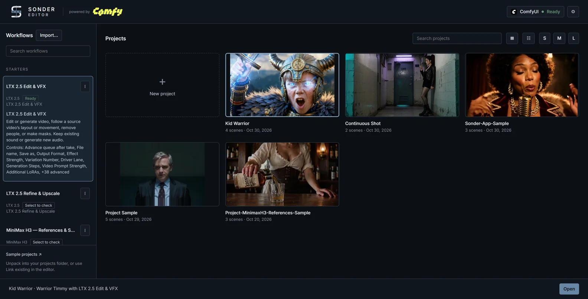

# Sonder App

The Sonder App runs exported ComfyUI workflows through the **Comfy SDK**
(`comfy-sdk`) and a local **API proxy** (`comfy-api-proxy`).

When you click **Generate**, Sonder combines the workflow's API JSON with your
current editor and Controls settings, then submits it through the SDK. The
proxy translates those requests into jobs for your running ComfyUI instance,
which executes the workflow using its installed nodes and models. **Sonder
Save Video** or **Sonder Save Bridge** returns the results to your project.

The canvas is where you build and wire the workflow. Once exported and
imported, the app provides its working interface: the timeline, Controls,
Modes and viewport Views.

Its **Launcher** lists your projects and workflows and opens the editor on
the pair you choose, with **Generate** (1–8 takes per click) beside **+ Queue**.

The app is optional: the editor and every node work without it.

<em>The Launcher: pick a workflow on the left and a project
on the right, then click <strong>Open</strong>.</em>

https://github.com/user-attachments/assets/6740db96-dc0f-438b-9512-52261e1405af

## Set it up

Do this once, in a browser on the ComfyUI machine.

1. On the ComfyUI canvas, double-click an empty spot, type **Sonder Editor** and
   pick it. On its card, create a project (or pick one), then click **Open
   Editor**.
2. Open **Settings**: the **⚙** at the right end of the toolbar just above the
   timeline, next to **?**. Scroll to the bottom; **Sonder App (experimental)**
   is the last section.
3. Click **Install**. It adds two packages, `comfy-sdk` 0.4.0 and
   `comfy-api-proxy` 0.1.6, to ComfyUI's Python. No restart is needed. If
   either is already installed at another version, or installing would change
   a package ComfyUI already has, it stops and says why; see
   [Troubleshooting](troubleshooting.md#install-in-settings--sonder-app-is-refused-or-doesnt-finish).

## Open the Launcher

- In **Settings ▸ Sonder App (experimental)**, click **Open Launcher**.
- Or open `http://127.0.0.1:<port>/sonder-editor/app`, with your ComfyUI port.
- On Windows, Install saves a **Sonder Launcher.url** shortcut in your Sonder
  projects folder (`ComfyUI/output/sonder-projects/` unless you changed it).
  Copy it to your Desktop, or anywhere else, to open the Launcher from there
  while ComfyUI runs. On macOS and Linux, bookmark the Launcher page instead.
- **Show Launcher Button In The Editor**, in the same Settings section, adds a
  Launcher button beside **⚙**.

## Choose a workflow

Choose a supplied workflow under **Starters** in the Launcher, or import your
own. See **[Sonder App Workflows](sonder-app-workflows.md)** for an introduction
to **LTX 2.5 Edit & VFX**, **LTX 2.5 Refine & Upscale**, and **MiniMax H3 — References & Swaps**.
Before its first run, follow [Install Models and Node Packs](sonder-app-setup.md)
for the node packs and model files it needs.

## Use your own workflow

Prepare your workflow on the ComfyUI canvas before exporting it.

1. **Connect your workflow to the editor.** Use exactly one **Sonder Editor**
   node. Connect the outputs your workflow needs—such as frames, prompts,
   sound, dimensions and frame count—to your generation nodes. See
   [Wiring your graph](generating.md#wiring-your-graph).
2. **Return results to your project.** Add **Sonder Save Video** or **Sonder
   Save Bridge**. Connect its `project` input to the Editor's `project` output,
   passing through other project-carrying nodes such as **Sonder Metadata
   Collector** if needed.
3. **Add outputs you want to inspect.** Connect output nodes such as **Preview
   Image** or **Sonder Preview Video** to useful intermediate results—for
   example, a mask, processed Driver or first-pass video. In the editor, open
   a viewport pane's source menu and choose **Add output…** to show one. See
   [Output Views](generating.md#output-views).
4. **Prepare branches you want to switch together.** Put their nodes in a
   canvas group or subgraph. Open the editor's **Controls** tab, click
   **Manage → + Setting**, and add the group or subgraph's **Enabled / Muted /
   Bypassed** switch. Create these switches before exporting. See
   [Switch nodes and groups](controls.md#switch-nodes-and-groups-on-and-off).
5. **Prepare the settings people will use.** In **Controls → Manage**, expose
   useful settings, give them clear names, and optionally add Modes and short
   notes. You can also name your Views and set their timing. See
   [Manage](controls.md#manage).
6. **Enable everything the app will need.** Before exporting, enable all
   required nodes, preview outputs and their parent subgraphs. **Export
   (API)** leaves out muted or bypassed nodes. If your normal setup turns
   branches off, save those combinations as Mode choices first.
7. **Export and import.** Save the canvas workflow, then choose ComfyUI's
   **Export (API)**. In the Launcher, click **Import…** in the Workflows area,
   or drop the API file there.

You can add or edit settings, Modes, notes and Views in the app afterward.
The underlying nodes and the switches that control branches must be prepared
on the canvas.

A workflow that needs node packs or model files you don't have is still
imported and still opens. A choice that needs them is
[greyed out under Modes](controls.md#in-the-sonder-app). **Generate** refuses
only when the Modes you chose need them, and names the choice. To install
them, follow [Install Models and Node Packs](sonder-app-setup.md#the-steps);
for node packs the Launcher names, see also
[The Launcher says *Missing node packs*](troubleshooting.md#the-launcher-says-missing-node-packs).

## Generate

1. In the Launcher, click **New project** in the project grid for an empty
   project (enter **Project name**, then **Create** or **Create and open**), or
   select an existing project.
2. Select the project **first**, then the workflow: selecting a project can
   bring back the workflow it last used.
3. Click **Open** in the bottom bar.
4. Prepare your media and prompts, then set **In / Out** above the timeline.
   Follow the workflow's notes in **Controls**, or the
   [Sonder App Workflows](sonder-app-workflows.md) instructions. For editor
   gestures, see [Make a first take](getting-started.md#make-a-first-take).
5. In **Controls**, check the required inputs and choose any Modes you need.
6. Leave the take count beside **Generate** at **×1** for a first test,
   then click **Generate**. **+ Queue** adds the job to the Render Queue
   instead.

Start with a short selection. For a personal workflow, check that the
result returns to the project and that its picture, sound and dimensions
match your intended setup.

## Use Controls and Views

Open **Controls** in the editor's left sidebar to change workflow settings.
Choose your **Modes** first, then adjust individual values.

To inspect an output, open the source menu at the top of a viewport pane and
choose its View. A mask or processed-video View can have its own **Run**
button, which runs that output's branch. Sampling previews update while
generation runs.

See [Controls](controls.md) and [Output Views](generating.md#output-views)
for the full instructions. The **Workflow** menu at the top of Controls
[switches workflows in place](controls.md#in-the-sonder-app).

## The local connection

When you open a workflow from the Launcher, Sonder starts a local connection to
ComfyUI (`comfy-api-proxy`) on a free port from 8189 to 8198, or reuses one
already serving this ComfyUI. It stops the one it started when ComfyUI exits or
after half an hour without a Sonder App session. ComfyUI started with its own
TLS options (`--tls-keyfile`, `--tls-certfile`) isn't supported. If Generate
can't connect, see
[Troubleshooting](troubleshooting.md#generate-says-the-sonder-app-couldnt-connect-to-comfyui).

## Takes made in the app

The app sends ComfyUI the workflow's API form, without the canvas workflow, so:

- a take's details say the workflow is **Not embedded**, and **Open Source
  Workflow** is unavailable for it;
- **Sonder Metadata Collector** sections are titled by their wired label, or the
  node's type, and a value from inside a subgraph is listed under the inner
  node.

**Controls at run** is still recorded, with the app's labels, groups and seed
modes.
